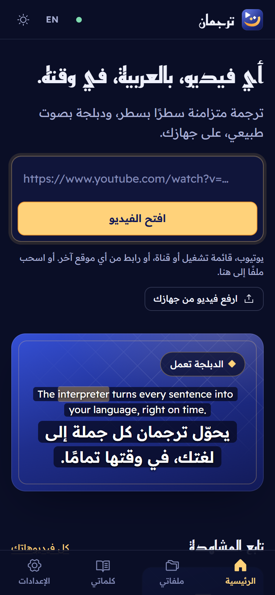

<p align="center">
  
</p>

<h1 align="center">Tarjuman · ترجمان</h1>

<p align="center">
  <strong>هر ویدیویی را به عربی تماشا کنید.</strong><br>
  ترجمه‌ی هم‌زمان، دوبله‌ی زنده با صدای طبیعی، MP4 دوبله‌شده و افزونه‌ی مرورگر. همه‌چیز روی رایانه‌ی خودتان اجرا می‌شود.
</p>

<p align="center">
  <a href="../../LICENSE"></a>
  
  
  
</p>

<p align="center">
  <a href="../../README.md">English</a> ·
  <a href="README.ar.md">العربية</a> ·
  <a href="README.fr.md">Français</a> ·
  <a href="README.es.md">Español</a> ·
  <a href="README.de.md">Deutsch</a> ·
  <a href="README.it.md">Italiano</a> ·
  <a href="README.pt.md">Português</a> ·
  <a href="README.tr.md">Türkçe</a> ·
  <a href="README.ru.md">Русский</a> ·
  <a href="README.ur.md">اردو</a> ·
  <b>فارسی</b> ·
  <a href="README.hi.md">हिन्दी</a> ·
  <a href="README.id.md">Bahasa Indonesia</a> ·
  <a href="README.zh.md">中文</a> ·
  <a href="README.ja.md">日本語</a> ·
  <a href="README.ko.md">한국어</a>
</p>

<p align="center">
  
</p>

<div dir="rtl">

## چه کاری انجام می‌دهد

یک پیوند YouTube بچسبانید، ویدیو یا فایل صوتی‌ای را از رایانه‌تان بارگذاری کنید، صدای خودتان را ضبط کنید، یا پیوندی از تقریباً هر سایتی به آن بدهید.

- **زیرنویس هم‌زمان.** زیرنویس عربی سطر به سطر روی ویدیو ظاهر می‌شود و اگر بخواهید، زبان اصلی هم زیر آن نمایش داده می‌شود. زیرنویس‌های خودکار پیش از ترجمه به جمله‌های کامل تبدیل می‌شوند. و اگر اصلاً نشانه‌گذاری نداشته باشند، با کمک زمان‌بندی تک‌تک واژه‌ها در YouTube، همان‌جایی بریده می‌شوند که گوینده واقعاً مکث می‌کند.
- **دوبله‌ی زنده‌ای که شبیه صدای انسان است.** یک صدای عربیِ مبتنی بر شبکه‌ی عصبی هر جمله را هم‌پای گوینده بیان می‌کند، به لهجه‌ی مصری، سعودی، اماراتی، سوری، اردنی، لبنانی، مراکشی یا عراقی. هیچ جمله‌ای بریده یا جا انداخته نمی‌شود. با گوینده‌ی تندگو، به جای اینکه صدا شتاب بگیرد، ویدیو کمی کند می‌شود تا صدا به آن برسد؛ اگر خودتان ویدیو را کند کنید، این زمان اضافه به صدا می‌رسد. واژه‌هایی که یکسان نوشته اما متفاوت خوانده می‌شوند، مطابق معنای جمله خوانده می‌شوند (الجُمَل یعنی «جمله‌ها»، نه الجَمَل یعنی «شتر») و این را متن اصلی انگلیسی تعیین می‌کند.
- **MP4 دوبله‌شده.** ویدیو را با صداگذاری عربی خروجی بگیرید. می‌تواند صدای گوینده‌ی اصلی را حذف کند و موسیقی و جلوه‌ها را نگه دارد، به هر گوینده صدای مردانه یا زنانه‌ی متناسب بدهد، و زیرنویس را جاسازی کند یا روی تصویر حک کند.
- **زیرنویس ندارد؟ مشکلی نیست.** Whisper صدا را روی رایانه‌ی شما به متن تبدیل می‌کند و سپس آن متن ترجمه می‌شود. بخش تنظیمات ← رونویسی رایانه‌ی شما را بررسی می‌کند (حافظه، کارت گرافیک، پردازنده)، مدلی پیشنهاد می‌دهد و دلیلش را می‌گوید، و اجازه می‌دهد برای ضبط‌ها، ویدیوها و شنیدن زنده مدل‌های متفاوتی انتخاب کنید. برای گفتار عربی مدلی هست که روی لهجه‌ها (مصری، خلیجی، شامی و دیگر لهجه‌ها) آموزش دیده و در آزمایش ما روی یک پیام صوتی مصری، واژه‌های بسیار کمتری را نسبت به مدل‌های معمولی اشتباه نوشت. می‌توانید فهرستی از واژه‌هایی که باید درست نوشته شوند (نام‌ها، محصولات، اصطلاحات انگلیسی‌ای که در گفتار عربی به کار می‌روند) همراه با شکل درست نوشتن هر کدام اضافه کنید، و در صورت تمایل اجازه دهید ارائه‌دهنده‌ی هوش مصنوعی‌تان متن را پس از رونویسی اصلاح کند. هر مدل Whisper با قالب CTranslate2 را می‌توان از Hugging Face یا از پوشه‌ای روی رایانه‌تان اضافه کرد، و مدل‌های دانلودشده را می‌توان برای آزاد کردن فضا حذف کرد.
- **فایل‌های صوتی و پیام‌های صوتی.** یک فایل MP3، M4A، WAV، OGG، Opus، FLAC یا پیام صوتی WhatsApp بارگذاری کنید، یا مستقیماً از میکروفون ضبط کنید. به جای صفحه‌ی خالی ویدیو، یک شکل موج متحرک همراه با متن هم‌زمان نمایش داده می‌شود، و خروجی آن می‌تواند زیرنویس، یک M4A دوبله‌شده، یا ویدیویی با شکل موج و زیرنویس حک‌شده برای اشتراک‌گذاری باشد.
- **فایل‌های زیرنویس.** SRT، VTT یا متن ساده را به عربی یا دوزبانه دانلود کنید، یا یک MP4 زیرنویس‌دار آماده‌ی اشتراک‌گذاری بگیرید.
- **کل فهرست‌های پخش.** پیوند یک فهرست پخش یا کانال را بدهید تا برای همه‌ی ویدیوهای آن زیرنویس، ویدیوی زیرنویس‌دار یا ویدیوی دوبله‌شده بسازد.
- **از ویدیو بپرسید** (هوش مصنوعی، اختیاری). خلاصه، نکته‌های کلیدی، فصل‌های قابل کلیک و پاسخ‌هایی بگیرید که شما را به لحظه‌ای می‌برند که ویدیو به پرسش شما می‌پردازد. با Claude یا هر ارائه‌دهنده‌ی سازگار با OpenAI (Gemini، Groq، OpenRouter، Ollama) کار می‌کند.
- **صفحه‌ی تماشایی که در اختیار شماست.** متن گفتار کنار ویدیو هر واژه را همان لحظه که گفته می‌شود روشن می‌کند، تغییر گوینده و صداهایی مثل [موسیقی] را مشخص می‌کند و قابل جست‌وجوست؛ روی هر سطر کلیک کنید تا به آن بروید. فصل‌هایی که صاحب ویدیو گذاشته (یا فصل‌های خلاصه‌ی هوش مصنوعی) سرعنوان بخش خودشان در متن می‌شوند و روی نوار زمانی علامت می‌خورند. نوار زمانی زیر ویدیو نشان می‌دهد سطرها کجا هستند، نوری ملایم به رنگ‌های خود ویدیو پشت پخش‌کننده می‌درخشد، و حالت سینما (<kbd>T</kbd>) همه‌چیز دیگر را تیره می‌کند. هر یک از این‌ها را می‌توان در تنظیمات ← تماشا خاموش یا تنظیم کرد. صفحه‌کلید: <kbd>→</kbd> سطر بعدی، <kbd>←</kbd> سطر قبلی، <kbd>R</kbd> تکرار، <kbd>K</kbd> پخش یا مکث، <kbd>?</kbd> برای فهرست کامل (با چیدمان صفحه‌کلید عربی هم کار می‌کنند).
- **انگلیسی یاد بگیرید.** روی هر واژه بزنید تا معنایش را ببینید، آن را همراه جمله‌اش ذخیره کنید، بعداً مرور کنید و به Anki بفرستید. همچنین می‌توانید یک جمله را تکرار کنید، پس از هر سطر مکث کنید، یا برای محک زدن خودتان زیرنویس را محو کنید.
- **افزونه‌ی مرورگر.** همین زیرنویس و دوبله را مستقیماً روی YouTube، روی ویدیوهای YouTube که در سایت‌های دیگر جاسازی شده‌اند، روی سایت‌هایی که پخش‌کننده‌شان زیرنویس دارد (Coursera، Udemy و دیگران)، روی سایت‌های فیلم و انیمه که پخش‌کننده‌شان را از سایت دیگری جاسازی می‌کنند، یا روی هر سایت دیگری با گوش دادن به صدای زبانه به کار ببرید. روی YouTube، متن گفتار را کنار ویدیو، معنای هر واژه‌ای که رویش کلیک کنید، میان‌بُرهای سطر به سطر و دکمه‌ای برای ادامه در برنامه اضافه می‌کند.
- **روی گوشی‌تان.** برنامه را از هر گوشی‌ای که به همان Wi-Fi وصل است باز کنید.

ترجمه و دوبله به **۷۴ زبان** ممکن است، هر کدام با صداهای بومی خودش (ژاپنی با صدای ژاپنی، هندی با صدای هندی)، و همه‌اش می‌تواند بدون اینترنت کار کند:

- **ترجمه‌ی آفلاین:** مدل یک زبان را یک بار دانلود کنید (تنظیمات ← ترجمه‌ی آفلاین) تا ترجمه روی رایانه‌ی خودتان انجام شود، وقتی Google در دسترس نیست یا همیشه.
- **صداهای آفلاین** در ۳۱ زبان که روی یک لپ‌تاپ معمولی به‌صورت زنده دوبله می‌کنند.
- **بسته‌های صدا** که فقط در صورت تمایل نصب می‌شوند: یک MP4 را **با صدای خودِ گوینده‌ی اصلی** (آزمایشی) یا **با صداهای لهجه‌های عربی** (مصری، عراقی، مراکشی…) دوبله کنید، روی رایانه‌ای با کارت گرافیک توانمند.

## تصاویر صفحه

<table>
  <tr>
    <td width="50%"></td>
    <td width="50%"></td>
  </tr>
  <tr>
    <td></td>
    <td></td>
  </tr>
  <tr>
    <td></td>
    <td></td>
  </tr>
</table>

<p align="center">
  
  
</p>

## شروع سریع

### نصب‌کننده‌ی Windows

فایل `Tarjuman-Setup-<version>.exe` را از صفحه‌ی [Releases](https://github.com/MohamedElnagar94/tarjuman/releases) دانلود و اجرا کنید. این نصب‌کننده Python مخصوص خودش، همه‌ی بسته‌ها، برنامه‌ی وب و افزونه‌ی مرورگر را همراه دارد، پس نه به Python نیاز دارید و نه به Node.js. یک بار دسترسی مدیر می‌خواهد، در Program Files نصب می‌شود و به دیوار آتش دست نمی‌زند. پس از آن ترجمان مثل هر برنامه‌ی دسکتاپ در پنجره‌ای از آنِ خودش باز می‌شود، بدون پنجره‌ی کنسول و بدون زبانه‌ی مرورگر. به‌طور پیش‌فرض با بستن پنجره، برنامه متوقف می‌شود؛ تنظیمات ← دسکتاپ می‌تواند به جای آن برنامه را در ناحیه‌ی اعلان‌ها نگه دارد، موتور را برای افزونه‌ی مرورگر در حال اجرا نگه دارد، و آن را همراه با Windows اجرا کند. (این پنجره همان Microsoft Edge در حالت برنامه است که در هر Windows 10 و 11 وجود دارد؛ چیز اضافه‌ای نصب نمی‌شود.)

- اگر نصب بلافاصله با پیام «unable to create the directory ...\Temp\is-*.tmp, access is denied» متوقف شد، فایل نصب‌کننده در پوشه‌ای قرار دارد که با سطح یکپارچگی پایین علامت خورده است (برخی ابزارهای سندباکس پوشه‌های کاری‌شان را این‌گونه علامت می‌زنند؛ در این حالت `icacls <file>` عبارت `Low Mandatory Level` را نشان می‌دهد). Windows چنین فایلی را با دسترسی کمتر اجرا می‌کند. آن را در پوشه‌ی دیگری مثل Downloads کپی کنید و همان نسخه‌ی کپی‌شده را اجرا کنید.
- نصب‌کننده هنوز امضای دیجیتال ندارد، پس ممکن است Windows SmartScreen بگوید «ناشر ناشناس»: گزینه‌ی *More info → Run anyway* را انتخاب کنید.
- در نخستین اجرا، صدای عربی آفلاین (حدود ۶۰ مگابایت) در پس‌زمینه دانلود می‌شود. مدل Whisper هم نخستین باری که ویدیویی به آن نیاز داشته باشد، خودش دانلود می‌شود.
- به‌روزرسانی‌ها: تنظیمات ← به‌روزرسانی‌ها نشان می‌دهد نسخه‌ی تازه چه چیزهایی اضافه و چه مشکلاتی را رفع می‌کند، و آن را با یک کلیک نصب می‌کند (یا اگر این گزینه را روشن کنید، خودبه‌خود).
- ویدیوها، زیرنویس‌ها، تنظیمات و فایل `.env` شما جدا از برنامه در `%LOCALAPPDATA%\Tarjuman` نگهداری می‌شوند. به‌روزرسانی آن‌ها را نگه می‌دارد؛ هنگام حذف برنامه از شما پرسیده می‌شود که پاک شوند یا نه.
- در منوی Start میان‌بُری به پوشه‌ی افزونه هست، برای استفاده با *بارگیری بسته‌نشده* در `chrome://extensions`.

چیزی کار نمی‌کند؟ [عیب‌یابی](../troubleshooting.md) را ببینید. تغییرات هر نسخه در [فهرست تغییرات](../../CHANGELOG.md) آمده است.

### Linux (AppImage)

فایل `Tarjuman-<version>-x86_64.AppImage` را از صفحه‌ی [Releases](https://github.com/MohamedElnagar94/tarjuman/releases) دانلود کنید، اجرایی‌اش کنید و اجرایش کنید. مانند نصب‌کننده‌ی Windows، Python مخصوص خودش، همه‌ی بسته‌ها، برنامه‌ی وب و افزونه را همراه دارد.

```sh
chmod +x Tarjuman-*-x86_64.AppImage
./Tarjuman-*-x86_64.AppImage
```

- اگر Chrome، Chromium یا Edge نصب باشد، در پنجره‌ای از آنِ خودش باز می‌شود، وگرنه در مرورگر پیش‌فرض شما (در این حالت تا وقتی از حساب کاربری خارج شوید، یا تا اجرای `pkill -f "tarjuman app"`، در حال اجرا می‌ماند).
- داده‌های شما در `~/.local/share/Tarjuman` نگهداری می‌شوند. تنظیمات ← به‌روزرسانی‌ها فایل AppImage را پس از بررسی، با نسخه‌ی تازه‌تر جایگزین می‌کند؛ برای استفاده از آن، ترجمان را دوباره اجرا کنید.
- اگر پیامی گفت FUSE وجود ندارد (در برخی توزیع‌ها و در WSL)، آن را با `--appimage-extract-and-run` اجرا کنید، یا `libfuse2` را نصب کنید.
- نماد ناحیه‌ی اعلان‌ها و تنظیمات دسکتاپ فعلاً فقط در Windows هستند.

### از کد منبع

به **Python 3.11+** و **Node.js 20+** نیاز دارید.

**Windows:** روی `start.cmd` دوبار کلیک کنید. اگر Windows پرسید که آیا اسکریپتی از ناشر ناشناس اجرا شود، یک بار با `powershell -ExecutionPolicy Bypass -File scripts/create-shortcut.ps1` میان‌بُری روی دسکتاپ بسازید و ترجمان را از آن اجرا کنید؛ این میان‌بُر همان اسکریپت را از طریق `cmd.exe` خودِ Windows اجرا می‌کند، پس آن پرسش نمایش داده نمی‌شود.

**macOS / Linux:**

```sh
./start.sh
```

در Debian، Ubuntu و Kali، اگر `python3-venv` نصب نیست، اول آن را نصب کنید (`sudo apt install python3-venv`).

اجرای نخست همه‌چیز را نصب می‌کند: بسته‌های Python، صدای عربی آفلاین و نسخه‌ی ساخته‌شده‌ی برنامه‌ی وب. سپس برنامه در `http://127.0.0.1:4318` باز می‌شود. در اجراهای بعدی ظرف چند ثانیه بالا می‌آید. برای استفاده از گوشی، نشانی‌ای را که برای Wi-Fi شما چاپ می‌کند باز کنید. در Windows، اگر گوشی به آن دسترسی ندارد، یک بار `scripts/allow-phone.ps1` را با دسترسی مدیر اجرا کنید: این اسکریپت Wi-Fi خانه‌تان را Private علامت می‌زند و درگاه‌های ترجمان را فقط روی شبکه‌های Private باز می‌کند.

<details>
<summary>راه‌اندازی دستی</summary>

```sh
python -m venv .venv
.venv/bin/pip install -r backend/requirements.txt        # Windows: .venv\Scripts\pip
npm --prefix frontend install && npm --prefix frontend run build
PYTHONPATH=backend .venv/bin/python -m tarjuman           # Windows: set PYTHONPATH=backend
```

</details>

### فرمان‌ها

| فرمان | کارکرد |
|---|---|
| `python -m tarjuman` | برنامه را اجرا می‌کند (`--port`، `--host 127.0.0.1` فقط برای همین رایانه، `--no-open`) |
| `python -m tarjuman app` | برنامه را به جای زبانه‌ی مرورگر در پنجره‌ای از آنِ خودش اجرا می‌کند (Edge یا Chrome در حالت برنامه)؛ در Windows همراه با نمادی در ناحیه‌ی اعلان‌ها (`--background` آن را بدون پنجره همان‌جا اجرا می‌کند) |
| `python -m tarjuman subs <link>` | فایل‌های زیرنویس را در `data/output` می‌نویسد (`--lang`، `--format srt,vtt,txt`) |
| `python -m tarjuman setup` | همه‌چیز را نصب یا تعمیر می‌کند |
| `python -m tarjuman update` | اگر دانلودها یا صداها از کار افتادند، yt-dlp و کلاینت صدا را به‌روز می‌کند |
| `python -m tarjuman doctor` | همه‌ی اجزا را بررسی می‌کند |

## افزونه‌ی مرورگر

<p align="center">
  
</p>

آن را مستقیم از [فروشگاه وب Chrome](https://chromewebstore.google.com/detail/gcfnomfbpenbhdebopmpdfamlaiodflp) نصب کنید، یا با مراحل زیر از کد منبع بسازید:

1. یک بار آن را بسازید: `npm --prefix extension install && npm --prefix extension run build`.
2. `chrome://extensions` (یا `edge://extensions`) را باز کنید، **حالت برنامه‌نویس** را روشن کنید، روی **بارگیری بسته‌نشده** کلیک کنید و `extension/dist` را انتخاب کنید.
3. برنامه را در حال اجرا نگه دارید، ویدیویی باز کنید و روی نماد ترجمان کلیک کنید، یا <kbd>Alt</kbd>+<kbd>Shift</kbd>+<kbd>A</kbd> را بزنید.
4. در صفحه‌ی گزینه‌های افزونه می‌توانید قلم زیرنویس، زبان افزونه (زبان مرورگر، عربی یا انگلیسی)، میان‌بُرهای صفحه‌کلید، و اینکه خودبه‌خود روی YouTube شروع شود یا نه (هرگز، همیشه، یا فقط روی کانال‌هایی که انتخاب می‌کنید) را تنظیم کنید.

در حین ترجمه:

- **متن گفتار کنار ویدیو** روی YouTube: همه‌ی سطرها، با سطر فعلی برجسته‌شده؛ روی سطری کلیک کنید تا به آن بروید، یا جست‌وجو کنید.
- **روی یک واژه** در سطر اصلی **کلیک کنید** تا معنایش را ببینید، و آن را همراه جمله‌اش در *واژه‌های من* در برنامه ذخیره کنید.
- **میان‌بُرها:** <kbd>Alt</kbd>+<kbd>→</kbd> سطر بعدی، <kbd>Alt</kbd>+<kbd>←</kbd> سطر قبلی، <kbd>Alt</kbd>+<kbd>↓</kbd> تکرار، <kbd>Alt</kbd>+<kbd>S</kbd> زیرنویس، <kbd>Alt</kbd>+<kbd>V</kbd> دوبله، <kbd>Alt</kbd>+<kbd>T</kbd> متن گفتار.
- **زمان‌بندی:** اگر سطرها زودتر یا دیرتر از گفتار می‌آیند، آن‌ها را با <kbd>Alt</kbd>+<kbd>[</kbd> و <kbd>Alt</kbd>+<kbd>]</kbd> جابه‌جا کنید (دوبله هم همراهشان جابه‌جا می‌شود).
- **باز کردن در برنامه** در همان لحظه، برای خروجی گرفتن و صفحه‌ی کامل تماشا.
- در مینی‌پلیر YouTube هم کار می‌کند، سایت آموزشی را تا درس بعدی دنبال می‌کند، و وقتی سایتی خودِ ویدیو را تمام‌صفحه می‌کند، باز هم سطر را نشان می‌دهد.

اگر Chrome هشدار *Proceed with caution: this extension is not trusted by Enhanced Safe Browsing* را نشان داد، به این دلیل است که ناشر در فروشگاه وب Chrome تازه‌وارد است: Chrome این هشدار را برای هر ناشر تازه نشان می‌دهد تا چند ماه از قوانین فروشگاه پیروی کند، و فقط به کسانی که محافظت پیشرفته را روشن کرده‌اند. افزونه بازبینی فروشگاه را گذرانده و [کد منبع](https://github.com/MohamedElnagar94/tarjuman/tree/main/extension) آن باز است. *Continue to install* را انتخاب کنید.

افزونه فقط با برنامه‌ی روی رایانه‌ی شما ارتباط دارد. بسته‌ی Chrome Web Store آن (متن صفحه، توجیه مجوزها، سیاست حریم خصوصی، تصاویر تبلیغاتی) در [`extension/store`](../../extension/store) است.

## دوبله چگونه هم‌زمان می‌ماند

سطرهای زیرنویس به جمله‌های کامل پیوند می‌خورند و واژه‌های پرکننده حذف می‌شوند. سپس سرعت هر جمله بر پایه‌ی پنجره‌ای پیش‌نگر حدوداً ۱۲ ثانیه‌ای انتخاب می‌شود؛ به این ترتیب جمله‌ای که جای کافی دارد به جمله‌ی فشرده وقت قرض می‌دهد و سرعت به‌تدریج تغییر می‌کند، نه ناگهانی. پیش از آنکه مرورگر نخستین جمله‌های هر بخش را پخش کند، سرور آن‌ها را سنتز و مدتشان را اندازه می‌گیرد، پس برنامه بر مدت‌های واقعی تکیه دارد نه حدس، و سرور بخش بعدی را در پس‌زمینه آماده می‌کند. اگر باز هم دوبله عقب بیفتد، ویدیو تا رسیدن صدا به ۸۵٪ سرعت شما کند می‌شود و فقط وقتی مکث می‌کند که فاصله از حدود دو ثانیه بیشتر شود. ضرباهنگ دوبله از سرعت پخش شما پیروی می‌کند. به هر نقطه‌ای که بروید، دوبله دقیقاً از همان‌جا ادامه می‌یابد. وقتی مترجم‌های رایگان تعداد درخواست‌ها را محدود می‌کنند، یک نقطه‌ی دسترسی دوم Google و سپس ترجمه‌ی خودِ YouTube دوبله را از کار نمی‌اندازند.

طراحی کامل در [docs/implementation.md](../implementation.md) آمده است.

## حریم خصوصی

ترجمان در درجه‌ی اول محلی است. ویدیوها، زیرنویس‌ها، واژه‌های ذخیره‌شده، تنظیمات و کلید API شما در پوشه‌ی `data/` روی رایانه‌تان می‌مانند. برنامه با YouTube (زیرنویس و دانلود)، Google Translate و MyMemory (ترجمه)، سرویس صدای Edge مایکروسافت (گفتار) و فقط اگر روشنش کنید، با ارائه‌دهنده‌ی هوش مصنوعی انتخابی شما تماس می‌گیرد. نه حساب کاربری در کار است، نه آمارگیری و نه ردیابی. تصویر و صدا هرگز به جایی فرستاده نمی‌شوند.

| قابلیت | آنچه از رایانه‌ی شما بیرون می‌رود | فرستاده می‌شود به | بدون فرستادن هیچ‌چیز |
|---|---|---|---|
| زیرنویس‌های YouTube | پیوند ویدیو | YouTube | یک فایل بارگذاری کنید؛ به‌صورت محلی رونویسی می‌شود |
| ترجمه | جمله‌های ویدیو، به‌صورت متن | Google Translate و سپس MyMemory | مدل‌های ترجمه‌ی آفلاین (تنظیمات ← ترجمه‌ی آفلاین) |
| صدای دوبله | هر جمله‌ی ترجمه‌شده و نام صدا | صداهای Microsoft Edge و سپس Google | صداهای آفلاین (Supertonic در ۳۱ زبان؛ Piper برای عربی) و بسته‌های صدا |
| دانلود ویدیو | درخواستی برای ویدیو | سایتی که میزبان آن است | فایلی که از پیش روی رایانه‌تان هست |
| هوش مصنوعی (اختیاری، به‌طور پیش‌فرض خاموش) | متن ویدیو و پرسش شما | ارائه‌دهنده‌ای که انتخاب کرده‌اید | خاموش نگهش دارید، یا از یک سرور محلی مثل Ollama استفاده کنید |
| دانلود مدل‌ها | یک درخواست دانلود، فقط یک بار | Hugging Face، GitHub، دانشگاه هلسینکی (مدل‌های ترجمه)، PyTorch و PyPI (بسته‌های صدا) | پس از نخستین دانلود، هیچ‌چیز |
| بررسی به‌روزرسانی | درخواستی برای فهرست نسخه‌های تازه‌تر، هر چند ساعت یک بار | GitHub | گزینه‌ی «بررسی خودکار به‌روزرسانی‌ها» را در تنظیمات ← به‌روزرسانی‌ها خاموش کنید |
| اصلاح متن رونویسی (اختیاری، به‌طور پیش‌فرض خاموش) | متن رونویسی | ارائه‌دهنده‌ی هوش مصنوعی‌ای که انتخاب کرده‌اید | خاموش نگهش دارید؛ فهرست واژه‌ها بدون آن هم کار می‌کند |
| بازشناسی گفتار، جداسازی موسیقی، فایل‌ها و ضبط‌های شما | هیچ‌چیز | – | همیشه محلی |

همین جدول در خود برنامه هم هست، در تنظیمات ← حریم خصوصی. API درخواست‌های سایت‌های دیگر را رد می‌کند و تنظیمات هوش مصنوعی فقط از رایانه‌ای که برنامه روی آن اجرا می‌شود قابل تغییر است.

## پیکربندی

در پوشه‌ی پروژه، `.env.example` را با نام `.env` کپی و ویرایش کنید؛ هر تنظیم همان‌جا به عربی و انگلیسی توضیح داده شده است. این فایل هنگام شروع به کار خوانده می‌شود، پس بعد از هر تغییر ترجمان را دوباره اجرا کنید. متغیری که در محیط واقعی تنظیم شده باشد بر فایل مقدم است.

| متغیر محیطی | پیش‌فرض | معنا |
|---|---|---|
| `TARJUMAN_HOME` | پوشه‌ی پروژه | جایی که `data/` نگهداری می‌شود |
| `TARJUMAN_PORT` | `4318` | نخستین درگاهی که امتحان می‌شود (اگر اشغال باشد، به درگاه بعدی می‌رود؛ افزونه هم دنبالش می‌کند) |
| `TARJUMAN_HOST` | `0.0.0.0` | با `127.0.0.1` برنامه از Wi-Fi شما در دسترس نخواهد بود |
| `TARJUMAN_WHISPER_MODEL` | (خالی) | در تنظیمات ← رونویسی انتخاب می‌شود که مدلی متناسب با رایانه‌ی شما پیشنهاد می‌دهد؛ مقداری که این‌جا بگذارید تا وقتی آن تنظیم روی «خودکار» است به کار می‌رود |
| `TARJUMAN_VOICE_CACHE_GB` | `2` | سقف حجم صداهای دوبله ذخیره‌شده؛ آن‌هایی که مدت بیشتری استفاده نشده‌اند زودتر حذف می‌شوند |
| `TARJUMAN_MAX_UPLOAD_GB` | `8` | بزرگ‌ترین ویدیویی که می‌توانید بارگذاری کنید |
| `TARJUMAN_PAIR_MINUTES` | `15` | مدت اعتبار کد جفت‌سازی گوشی (همان QR)؛ `0` = تا وقتی کد تازه‌ای بسازید |
| `TARJUMAN_FETCH_PRIVATE` | خاموش | برای مجاز کردن دانلود از نشانی‌های درون شبکه‌ی خودتان، آن را `1` بگذارید |
| `TARJUMAN_HEAVY_JOBS` | `2` | تعداد کارهای سنگینی (Whisper، دوبله، حک زیرنویس روی تصویر) که هم‌زمان اجرا می‌شوند؛ روی رایانه‌ی کم‌حافظه `1` بگذارید |
| `TARJUMAN_MAX_QUEUE` | `20` | بیشترین تعداد کارهایی که می‌توانند در نوبت بمانند |
| `TARJUMAN_FORCE_ASR` | خاموش | برای اینکه رونویسی همیشه با Whisper انجام شود و زیرنویس‌های YouTube نادیده گرفته شوند، آن را `1` بگذارید |
| `ANTHROPIC_API_KEY` | – | وقتی کلیدی در تنظیمات ذخیره نشده باشد، برای Claude به کار می‌رود |

## ساختار پروژه

```
backend/     Python package `tarjuman` (FastAPI): captions, translation, voices, dubbing, AI, jobs
frontend/    Vue 3 + Vite + TypeScript web app
extension/   Chrome / Edge extension (Manifest V3, Vue + Vite) and its store kit
shared/      the live dub engine used by both the web app and the extension
assets/      brand (icon source and renders)
docs/        plan, specification, implementation notes, translated READMEs, screenshots
```

## توسعه

```sh
# backend tests (offline)
cd backend && ../.venv/bin/python -m pytest      # Windows: ..\.venv\Scripts\python

# dub engine tests
npm test

# web app with hot reload (proxies the API to 127.0.0.1:4318)
npm --prefix frontend run dev

# extension: build, test, package a store zip
npm --prefix extension run build && npm --prefix extension test && npm --prefix extension run package
```

پیش از تغییر هر مسیر API، [docs/specs.md](../specs.md) را بخوانید: هم برنامه‌ی وب و هم افزونه به آن وابسته‌اند.

### ساخت نصب‌کننده‌ی Windows

```powershell
powershell -ExecutionPolicy Bypass -File installer\build.ps1   # build\windows\app: Python, packages, web app, extension
iscc /DAppVersion=3.0.0 installer\tarjuman.iss                # build\windows\Tarjuman-Setup-3.0.0.exe (Inno Setup 6)
```

گردش‌کار *Windows installer* همین کار را روی GitHub انجام می‌دهد: آن را از زبانه‌ی Actions اجرا کنید، یا برچسبی مثل `v3.0.0` را push کنید تا نصب‌کننده به یک انتشار پیوست شود. پیش از کامپایل، برنامه‌ی بسته‌بندی‌شده را اجرا می‌کند و بررسی می‌کند که پاسخ بدهد.

### ساخت AppImage برای Linux

```sh
installer/linux/build.sh   # build/linux/Tarjuman-<version>-x86_64.AppImage (needs curl, python3, Node.js 20+)
```

یک Python قابل جابه‌جایی از python-build-standalone را درون خود بسته‌بندی می‌کند. همان گردش‌کار آن را کنار نصب‌کننده‌ی Windows می‌سازد و با هر برچسب `v*` هر دو را منتشر می‌کند.

## ساخته‌شده با

[faster-whisper](https://github.com/SYSTRAN/faster-whisper) ·
[edge-tts](https://github.com/rany2/edge-tts) ·
[Piper](https://github.com/rhasspy/piper) ·
[yt-dlp](https://github.com/yt-dlp/yt-dlp) ·
[مدل‌های MDX-Net از Ultimate Vocal Remover](https://github.com/TRvlvr/model_repo) ·
[FastAPI](https://fastapi.tiangolo.com) ·
[Vue](https://vuejs.org) ·
[Claude](https://www.anthropic.com/claude)

## مجوز

[MIT](../../LICENSE). دانلود ویدیو و زیرنویس تابع شرایط هر سایت است. ترجمان را برای محتوایی به کار ببرید که اجازه‌ی تماشا و اقتباس آن را دارید.

</div>
