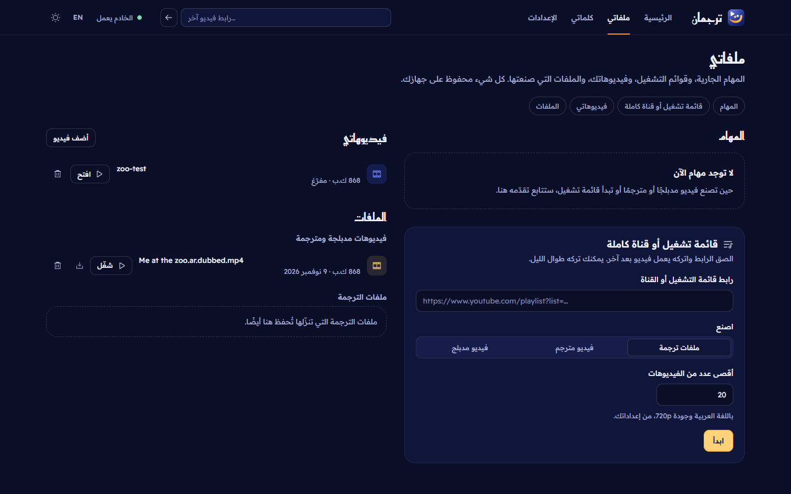
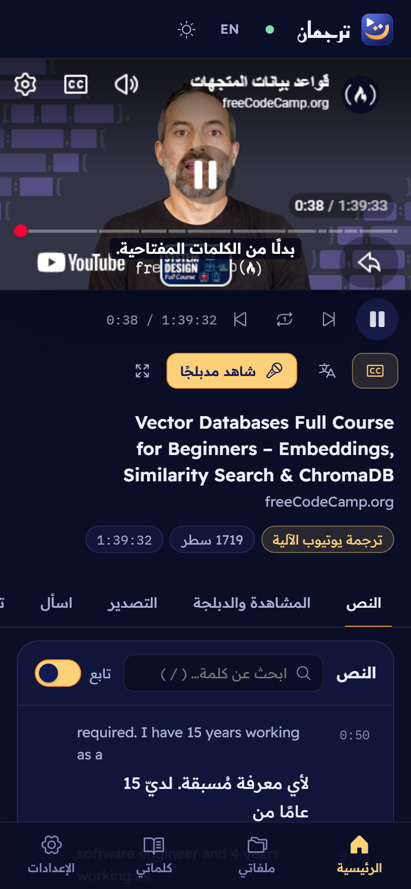
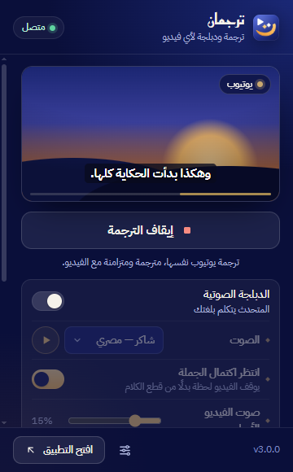

<p align="center">
  
</p>

<h1 align="center">Tarjuman · ترجمان</h1>

<p align="center">
  <strong>Regardez n'importe quelle vidéo en arabe.</strong><br>
  Traduction synchronisée, doublage en direct naturel, MP4 doublés et extension de navigateur. Tout tourne sur votre propre ordinateur.
</p>

<p align="center">
  <a href="../../LICENSE"></a>
  
  
  
</p>

<p align="center">
  <a href="../../README.md">English</a> ·
  <a href="README.ar.md">العربية</a> ·
  <b>Français</b> ·
  <a href="README.es.md">Español</a> ·
  <a href="README.de.md">Deutsch</a> ·
  <a href="README.it.md">Italiano</a> ·
  <a href="README.pt.md">Português</a> ·
  <a href="README.tr.md">Türkçe</a> ·
  <a href="README.ru.md">Русский</a> ·
  <a href="README.ur.md">اردو</a> ·
  <a href="README.fa.md">فارسی</a> ·
  <a href="README.hi.md">हिन्दी</a> ·
  <a href="README.id.md">Bahasa Indonesia</a> ·
  <a href="README.zh.md">中文</a> ·
  <a href="README.ja.md">日本語</a> ·
  <a href="README.ko.md">한국어</a>
</p>

<p align="center">
  
</p>

## Ce que fait Tarjuman

Collez un lien YouTube, importez une vidéo ou un fichier audio depuis votre ordinateur, enregistrez votre propre voix ou donnez-lui un lien provenant de presque n'importe quel site.

- **Sous-titres synchronisés.** Les sous-titres arabes s'affichent sur la vidéo ligne par ligne, avec la langue d'origine en dessous si vous le souhaitez. Les sous-titres générés automatiquement sont reconstitués en phrases complètes avant d'être traduits. Lorsqu'ils n'ont aucune ponctuation, ils sont découpés là où l'orateur marque réellement une pause, grâce au minutage mot par mot de YouTube.
- **Un doublage en direct qui sonne humain.** Une voix arabe neuronale prononce chaque phrase en rythme avec l'orateur, en arabe égyptien, saoudien, émirien, syrien, jordanien, libanais, marocain ou irakien. Aucune phrase n'est coupée ni sautée. Face à un orateur rapide, la vidéo ralentit légèrement le temps que la voix rattrape son retard, au lieu que la voix s'emballe ; ralentissez vous-même la vidéo et la voix profite de ce temps supplémentaire. Les mots qui s'écrivent de la même façon mais se lisent différemment sont prononcés selon le sens de la phrase (الجُمَل « les phrases », et non الجَمَل « le chameau »), d'après l'original anglais.
- **MP4 doublé.** Exportez la vidéo avec la voix off arabe. Tarjuman peut supprimer la voix de l'orateur d'origine tout en conservant la musique et les effets, attribuer à chaque intervenant une voix masculine ou féminine adaptée, et intégrer ou incruster les sous-titres.
- **Pas de sous-titres ? Aucun problème.** Whisper transcrit l'audio sur votre ordinateur, puis la transcription est traduite. Réglages → Transcription examine votre ordinateur (mémoire, carte graphique, processeur), recommande un modèle en expliquant pourquoi, et vous laisse choisir un modèle différent pour les enregistrements, pour les vidéos et pour l'écoute en direct. Pour l'arabe parlé, un modèle entraîné sur les dialectes (égyptien, du Golfe, levantin et d'autres) a fait bien moins d'erreurs de mots que les modèles standard lors de notre test sur un message vocal égyptien. Vous pouvez ajouter une liste de mots qu'il doit reconnaître correctement (noms, produits, termes anglais prononcés en arabe), avec la façon dont chacun doit s'écrire, et laisser éventuellement votre fournisseur d'IA corriger la transcription ensuite. Tout modèle Whisper au format CTranslate2 peut être ajouté, depuis Hugging Face ou depuis un dossier de votre ordinateur, et les modèles téléchargés peuvent être supprimés pour libérer de l'espace.
- **Fichiers audio et messages vocaux.** Importez un fichier MP3, M4A, WAV, OGG, Opus ou FLAC, ou un message vocal WhatsApp, ou enregistrez directement depuis votre micro. Au lieu d'une vidéo vide, vous obtenez une forme d'onde animée avec la transcription synchronisée, et vous pouvez exporter des sous-titres, un M4A doublé, ou une vidéo avec la forme d'onde et les sous-titres incrustés, prête à partager.
- **Fichiers de sous-titres.** Téléchargez du SRT, du VTT ou du texte brut, en arabe ou bilingue, ou un MP4 sous-titré prêt à partager.
- **Playlists entières.** Donnez-lui le lien d'une playlist ou d'une chaîne pour produire des sous-titres, des vidéos sous-titrées ou des vidéos doublées pour chacune de ses vidéos.
- **Interrogez la vidéo** (IA facultative). Obtenez un résumé, les points clés, des chapitres cliquables et des réponses qui vous amènent au moment où la vidéo traite votre question. Fonctionne avec Claude ou tout fournisseur compatible OpenAI (Gemini, Groq, OpenRouter, Ollama).
- **Une page de visionnage à votre main.** La transcription à côté de la vidéo met en surbrillance chaque mot au moment où il est prononcé, signale les changements d'intervenant et les sons comme [musique], et peut être parcourue par recherche ; cliquez sur une ligne pour y aller. Les chapitres définis par le propriétaire de la vidéo (ou issus du résumé de l'IA) servent de titres à leur partie de la transcription et sont marqués sur la barre de progression. Une frise sous la vidéo montre où se trouvent les lignes, une douce lumière aux couleurs de la vidéo rayonne derrière le lecteur, et le mode cinéma (<kbd>T</kbd>) assombrit tout le reste. Chacun de ces éléments peut être désactivé ou ajusté dans Réglages → Visionnage. Clavier : <kbd>→</kbd> ligne suivante, <kbd>←</kbd> ligne précédente, <kbd>R</kbd> répéter, <kbd>K</kbd> lecture ou pause, <kbd>?</kbd> pour la liste complète (ces raccourcis fonctionnent aussi avec une disposition de clavier arabe).
- **Apprenez l'anglais.** Touchez un mot pour voir sa signification, enregistrez-le avec sa phrase, révisez-le plus tard et exportez-le vers Anki. Vous pouvez aussi répéter une phrase, faire une pause après chaque ligne ou flouter les sous-titres pour vous tester.
- **Extension de navigateur.** Profitez des mêmes sous-titres et du même doublage directement sur YouTube, sur les vidéos YouTube intégrées à d'autres sites, sur les sites dont le lecteur propose des sous-titres (Coursera, Udemy et d'autres), sur les sites de films et d'animes qui intègrent un lecteur hébergé sur un autre site, ou sur n'importe quel autre site en écoutant l'audio de l'onglet. Sur YouTube, elle ajoute une transcription à côté de la vidéo, la signification de tout mot sur lequel vous cliquez, des raccourcis ligne par ligne et un bouton pour continuer dans l'application.
- **Sur votre téléphone.** Ouvrez l'application depuis n'importe quel téléphone connecté au même Wi-Fi.

**74 langues** sont disponibles pour la traduction et le doublage, chacune avec des voix natives (le japonais sonne japonais, le hindi sonne hindi), et tout peut fonctionner sans Internet :

- **Traduction hors ligne :** téléchargez une fois le modèle d'une langue (Réglages → Traduction hors ligne) et la traduction s'exécute sur votre ordinateur, lorsque Google n'est pas disponible ou en permanence.
- **Voix hors ligne** dans 31 langues, qui doublent en direct sur un ordinateur portable ordinaire.
- **Packs de voix**, installés seulement si vous le souhaitez : doublez un MP4 avec **la propre voix de l'orateur d'origine** (expérimental), ou avec des **voix en dialectes arabes** (égyptien, irakien, marocain…) sur un ordinateur doté d'une carte graphique performante.

## Captures d'écran

<table>
  <tr>
    <td width="50%"></td>
    <td width="50%"></td>
  </tr>
  <tr>
    <td></td>
    <td></td>
  </tr>
  <tr>
    <td></td>
    <td></td>
  </tr>
</table>

<p align="center">
  
  
</p>

## Démarrage rapide

### Installateur Windows

Téléchargez `Tarjuman-Setup-<version>.exe` depuis la page [Releases](https://github.com/MohamedElnagar94/tarjuman/releases) et exécutez-le. Il apporte son propre Python, tous les paquets, l'application web et l'extension de navigateur : vous n'avez donc besoin ni de Python ni de Node.js. Il demande les droits d'administrateur une seule fois, s'installe dans Program Files et ne touche pas au pare-feu. Tarjuman s'ouvre ensuite dans sa propre fenêtre, comme n'importe quelle application de bureau, sans fenêtre de console ni onglet de navigateur. Par défaut, fermer la fenêtre l'arrête ; Réglages → Bureau permet plutôt de le garder dans la zone de notification, de laisser le moteur tourner pour l'extension de navigateur et de le lancer au démarrage de Windows. (La fenêtre est Microsoft Edge en mode application, présent sur tous les Windows 10 et 11 ; rien de plus n'est installé.)

- Si l'installation s'arrête aussitôt avec « unable to create the directory ...\Temp\is-*.tmp, access is denied », c'est que le fichier de l'installateur se trouve dans un dossier marqué à faible niveau d'intégrité (certains outils de bac à sable marquent ainsi leurs dossiers de travail ; `icacls <file>` affiche alors `Low Mandatory Level`). Windows exécute un tel fichier avec moins de droits. Copiez-le dans un autre dossier, par exemple Téléchargements, et exécutez la copie.
- L'installateur n'est pas encore signé numériquement, si bien que Windows SmartScreen peut indiquer « éditeur inconnu » : choisissez *Informations complémentaires → Exécuter quand même*.
- Le premier démarrage télécharge la voix arabe hors ligne (environ 60 Mo) en arrière-plan. Le modèle Whisper se télécharge tout seul la première fois qu'une vidéo en a besoin.
- Mises à jour : Réglages → Mises à jour montre ce qu'une nouvelle version ajoute et corrige, et l'installe en un clic (ou toute seule, si vous activez cette option).
- Vos vidéos, sous-titres, réglages et le fichier `.env` sont conservés dans `%LOCALAPPDATA%\Tarjuman`, à l'écart du programme. Une mise à jour les conserve ; la désinstallation vous demande s'il faut les supprimer.
- Le menu Démarrer contient un raccourci vers le dossier de l'extension, pour *Charger l'extension non empaquetée* dans `chrome://extensions`.

Quelque chose ne fonctionne pas ? Consultez le [Dépannage](../troubleshooting.md). Les changements de chaque version figurent dans le [journal des modifications](../../CHANGELOG.md).

### Linux (AppImage)

Téléchargez `Tarjuman-<version>-x86_64.AppImage` depuis la page [Releases](https://github.com/MohamedElnagar94/tarjuman/releases), rendez-le exécutable et lancez-le. Comme l'installateur Windows, il apporte son propre Python, tous les paquets, l'application web et l'extension.

```sh
chmod +x Tarjuman-*-x86_64.AppImage
./Tarjuman-*-x86_64.AppImage
```

- Il s'ouvre dans sa propre fenêtre si Chrome, Chromium ou Edge est installé, et sinon dans votre navigateur par défaut (il continue alors de tourner jusqu'à ce que vous fermiez votre session, ou jusqu'à `pkill -f "tarjuman app"`).
- Vos données sont conservées dans `~/.local/share/Tarjuman`. Réglages → Mises à jour remplace l'AppImage par une version plus récente après l'avoir vérifiée ; redémarrez Tarjuman pour l'utiliser.
- S'il indique que FUSE est manquant (sur certaines distributions et sous WSL), lancez-le avec `--appimage-extract-and-run`, ou installez `libfuse2`.
- L'icône de la zone de notification et les réglages Bureau sont pour l'instant réservés à Windows.

### Depuis les sources

Il vous faut **Python 3.11+** et **Node.js 20+**.

**Windows :** double-cliquez sur `start.cmd`. Si Windows vous demande s'il faut exécuter un script d'un éditeur inconnu, créez une fois pour toutes un raccourci sur le bureau avec `powershell -ExecutionPolicy Bypass -File scripts/create-shortcut.ps1` et lancez Tarjuman depuis ce raccourci : il exécute le même script via le `cmd.exe` de Windows, si bien que l'avertissement n'apparaît pas.

**macOS / Linux :**

```sh
./start.sh
```

Sous Debian, Ubuntu et Kali, installez d'abord `python3-venv` s'il manque (`sudo apt install python3-venv`).

Le premier lancement installe tout : les paquets Python, la voix arabe hors ligne et une version compilée de l'application web. L'application s'ouvre ensuite sur `http://127.0.0.1:4318`. Les fois suivantes, elle démarre en quelques secondes. Pour l'utiliser depuis votre téléphone, ouvrez l'adresse qu'elle affiche pour votre Wi-Fi. Sous Windows, si le téléphone n'arrive pas à s'y connecter, exécutez une fois `scripts/allow-phone.ps1` en tant qu'administrateur : il définit votre Wi-Fi domestique comme réseau privé et n'ouvre les ports de Tarjuman que sur les réseaux privés.

<details>
<summary>Installation manuelle</summary>

```sh
python -m venv .venv
.venv/bin/pip install -r backend/requirements.txt        # Windows: .venv\Scripts\pip
npm --prefix frontend install && npm --prefix frontend run build
PYTHONPATH=backend .venv/bin/python -m tarjuman           # Windows: set PYTHONPATH=backend
```

</details>

### Commandes

| Commande | Rôle |
|---|---|
| `python -m tarjuman` | Lance l'application (`--port`, `--host 127.0.0.1` pour cet ordinateur uniquement, `--no-open`) |
| `python -m tarjuman app` | Lance l'application dans sa propre fenêtre (Edge ou Chrome en mode application) au lieu d'un onglet de navigateur ; sous Windows avec une icône dans la zone de notification (`--background` l'y lance sans fenêtre) |
| `python -m tarjuman subs <link>` | Écrit les fichiers de sous-titres dans `data/output` (`--lang`, `--format srt,vtt,txt`) |
| `python -m tarjuman setup` | Installe ou répare tout |
| `python -m tarjuman update` | Met à jour yt-dlp et le client vocal, si les téléchargements ou les voix ne fonctionnent plus |
| `python -m tarjuman doctor` | Vérifie chaque composant |

## L'extension de navigateur

<p align="center">
  
</p>

Installez-la directement depuis le [Chrome Web Store](https://chromewebstore.google.com/detail/gcfnomfbpenbhdebopmpdfamlaiodflp), ou compilez-la depuis les sources avec les étapes suivantes :

1. Compilez-la une fois : `npm --prefix extension install && npm --prefix extension run build`.
2. Ouvrez `chrome://extensions` (ou `edge://extensions`), activez le **Mode développeur**, cliquez sur **Charger l'extension non empaquetée** et choisissez `extension/dist`.
3. Laissez l'application tourner, ouvrez une vidéo et cliquez sur l'icône Tarjuman, ou appuyez sur <kbd>Alt</kbd>+<kbd>Shift</kbd>+<kbd>A</kbd>.
4. Sa page d'options règle la police des sous-titres, la langue de l'extension (celle du navigateur, l'arabe ou l'anglais), les raccourcis clavier et si elle démarre toute seule sur YouTube (jamais, toujours, ou seulement sur les chaînes que vous choisissez).

Pendant la traduction :

- **Transcription à côté de la vidéo** sur YouTube : toutes les lignes, la ligne en cours mise en surbrillance ; cliquez sur une ligne pour y aller, ou faites une recherche.
- **Cliquez sur un mot** de la ligne d'origine pour voir sa signification, et enregistrez-le avec sa phrase dans *Mes mots* dans l'application.
- **Raccourcis :** <kbd>Alt</kbd>+<kbd>→</kbd> ligne suivante, <kbd>Alt</kbd>+<kbd>←</kbd> ligne précédente, <kbd>Alt</kbd>+<kbd>↓</kbd> répéter, <kbd>Alt</kbd>+<kbd>S</kbd> sous-titres, <kbd>Alt</kbd>+<kbd>V</kbd> doublage, <kbd>Alt</kbd>+<kbd>T</kbd> transcription.
- **Synchronisation :** si les lignes arrivent avant ou après la parole, décalez-les avec <kbd>Alt</kbd>+<kbd>[</kbd> et <kbd>Alt</kbd>+<kbd>]</kbd> (le doublage se décale avec elles).
- **Ouvrir dans l'application** au même moment, pour les exports et la page de visionnage complète.
- Elle continue de fonctionner dans le mini-lecteur de YouTube, suit un site de cours jusqu'à la leçon suivante, et affiche toujours la ligne lorsqu'un site passe la vidéo seule en plein écran.

Si Chrome affiche *Proceed with caution: this extension is not trusted by Enhanced Safe Browsing*, c'est que l'éditeur est nouveau sur le Chrome Web Store : Chrome l'affiche pour tout nouvel éditeur jusqu'à ce qu'il ait respecté les règles du store pendant quelques mois, et seulement aux personnes qui ont activé la protection renforcée. L'extension a passé l'examen du store et son [code source](https://github.com/MohamedElnagar94/tarjuman/tree/main/extension) est ouvert. Choisissez *Continue to install*.

L'extension communique uniquement avec l'application sur votre ordinateur. Son kit pour le Chrome Web Store (texte de la fiche, justification des autorisations, politique de confidentialité, images promotionnelles) se trouve dans [`extension/store`](../../extension/store).

## Comment le doublage reste synchronisé

Les lignes de sous-titres sont fusionnées en phrases complètes et les mots de remplissage sont supprimés. La vitesse de chaque phrase est ensuite choisie à partir d'une fenêtre d'anticipation d'environ 12 secondes : une phrase qui a de la marge prête du temps à une phrase chargée, et la vitesse change progressivement au lieu de sauter. Avant que le navigateur ne joue les premières phrases de chaque passage, le serveur les synthétise et les mesure, si bien que le plan repose sur des durées réelles et non sur des estimations, et il prépare le passage suivant en arrière-plan. Si le doublage prend tout de même du retard, la vidéo ralentit à 85 % de votre vitesse jusqu'à ce que la voix la rattrape, et ne se met en pause que lorsque l'écart dépasse environ deux secondes. Le rythme suit votre vitesse de lecture. Où que vous vous déplaciez dans la vidéo, le doublage reprend exactement au bon endroit. Lorsque les traducteurs gratuits limitent le nombre de requêtes, un second point d'accès Google, puis la traduction de YouTube elle-même, prennent le relais pour que le doublage continue.

La conception complète est décrite dans [docs/implementation.md](../implementation.md).

## Confidentialité

Tarjuman privilégie le local. Vos vidéos, sous-titres, mots enregistrés, réglages et clé d'API restent dans le dossier `data/` de votre ordinateur. L'application contacte YouTube (sous-titres et téléchargements), Google Translate et MyMemory (traduction), le service vocal Edge de Microsoft (synthèse vocale) et, uniquement si vous l'activez, le fournisseur d'IA de votre choix. Aucun compte, aucune statistique, aucun pistage. La vidéo et l'audio ne sont jamais envoyés où que ce soit.

| Fonction | Ce qui quitte votre ordinateur | Envoyé à | Sans rien envoyer |
|---|---|---|---|
| Sous-titres YouTube | Le lien de la vidéo | YouTube | Envoyez un fichier ; il est transcrit en local |
| Traduction | Les phrases de la vidéo, sous forme de texte | Google Translate, puis MyMemory | Les modèles de traduction hors ligne (Réglages → Traduction hors ligne) |
| Voix du doublage | Chaque phrase traduite et le nom de la voix | Voix Microsoft Edge, puis Google | Les voix hors ligne (Supertonic, 31 langues ; Piper pour l'arabe) et les packs de voix |
| Téléchargement de vidéo | Une requête pour la vidéo | Le site qui l'héberge | Un fichier déjà présent sur votre ordinateur |
| IA (facultative, désactivée par défaut) | Le texte de la vidéo et votre question | Le fournisseur que vous avez choisi | Laissez-la désactivée, ou utilisez un serveur local comme Ollama |
| Téléchargements de modèles | Une requête de téléchargement, une seule fois | Hugging Face, GitHub, l'Université d'Helsinki (modèles de traduction), PyTorch et PyPI (packs de voix) | Rien après le premier téléchargement |
| Vérification des mises à jour | Une requête pour la liste des versions plus récentes, toutes les quelques heures | GitHub | Désactivez « Rechercher automatiquement les mises à jour » dans Réglages → Mises à jour |
| Correction de la transcription (facultative, désactivée par défaut) | Le texte de la transcription | Le fournisseur d'IA que vous avez choisi | Laissez-la désactivée ; la liste de mots fonctionne sans elle |
| Reconnaissance vocale, séparation de la musique, vos fichiers et enregistrements | Rien | – | Toujours en local |

Le même tableau se trouve dans l'application, sous Réglages → Confidentialité. L'API refuse les requêtes provenant d'autres sites, et les réglages d'IA ne peuvent être modifiés que depuis l'ordinateur qui exécute l'application.

## Configuration

Copiez `.env.example` vers `.env` dans le dossier du projet et modifiez-le ; chaque réglage y est expliqué, en arabe et en anglais. Le fichier est lu au démarrage : redémarrez donc Tarjuman après une modification. Une variable définie dans l'environnement réel l'emporte sur le fichier.

| Variable d'environnement | Valeur par défaut | Signification |
|---|---|---|
| `TARJUMAN_HOME` | dossier du projet | Emplacement de `data/` |
| `TARJUMAN_PORT` | `4318` | Premier port essayé (il passe au suivant si le port est occupé ; l'extension suit) |
| `TARJUMAN_HOST` | `0.0.0.0` | Utilisez `127.0.0.1` pour rendre l'application inaccessible depuis votre Wi-Fi |
| `TARJUMAN_WHISPER_MODEL` | (vide) | Choisi dans Réglages → Transcription, qui en recommande un pour votre ordinateur ; une valeur définie ici est utilisée tant que ce réglage est sur Automatique |
| `TARJUMAN_VOICE_CACHE_GB` | `2` | Taille maximale des voix de doublage enregistrées ; les moins récemment utilisées sont supprimées d'abord |
| `TARJUMAN_MAX_UPLOAD_GB` | `8` | Taille maximale d'une vidéo que vous pouvez envoyer |
| `TARJUMAN_PAIR_MINUTES` | `15` | Durée de validité d'un code d'appairage du téléphone (le QR) ; `0` = jusqu'à ce que vous en génériez un nouveau |
| `TARJUMAN_FETCH_PRIVATE` | désactivé | Mettez `1` pour autoriser le téléchargement depuis des adresses de votre propre réseau |
| `TARJUMAN_HEAVY_JOBS` | `2` | Nombre de tâches lourdes (Whisper, doublage, incrustation des sous-titres) exécutées en même temps ; utilisez `1` sur un ordinateur qui a peu de mémoire |
| `TARJUMAN_MAX_QUEUE` | `20` | Nombre maximal de tâches pouvant attendre leur tour |
| `TARJUMAN_FORCE_ASR` | désactivé | Mettez `1` pour toujours transcrire avec Whisper, sans tenir compte des sous-titres de YouTube |
| `ANTHROPIC_API_KEY` | – | Utilisée pour Claude si aucune clé n'est enregistrée dans les réglages |

## Structure du projet

```
backend/     Python package `tarjuman` (FastAPI): captions, translation, voices, dubbing, AI, jobs
frontend/    Vue 3 + Vite + TypeScript web app
extension/   Chrome / Edge extension (Manifest V3, Vue + Vite) and its store kit
shared/      the live dub engine used by both the web app and the extension
assets/      brand (icon source and renders)
docs/        plan, specification, implementation notes, translated READMEs, screenshots
```

## Développement

```sh
# backend tests (offline)
cd backend && ../.venv/bin/python -m pytest      # Windows: ..\.venv\Scripts\python

# dub engine tests
npm test

# web app with hot reload (proxies the API to 127.0.0.1:4318)
npm --prefix frontend run dev

# extension: build, test, package a store zip
npm --prefix extension run build && npm --prefix extension test && npm --prefix extension run package
```

Lisez [docs/specs.md](../specs.md) avant de modifier une route de l'API : l'application web et l'extension en dépendent toutes les deux.

### Compiler l'installateur Windows

```powershell
powershell -ExecutionPolicy Bypass -File installer\build.ps1   # build\windows\app: Python, packages, web app, extension
iscc /DAppVersion=3.0.0 installer\tarjuman.iss                # build\windows\Tarjuman-Setup-3.0.0.exe (Inno Setup 6)
```

Le workflow *Windows installer* fait la même chose sur GitHub : lancez-le depuis l'onglet Actions, ou poussez un tag comme `v3.0.0` pour joindre l'installateur à une release. Avant de compiler, il démarre l'application embarquée et vérifie qu'elle répond.

### Compiler l'AppImage Linux

```sh
installer/linux/build.sh   # build/linux/Tarjuman-<version>-x86_64.AppImage (needs curl, python3, Node.js 20+)
```

Elle embarque un Python relocalisable issu de python-build-standalone. Le même workflow la compile à côté de l'installateur Windows et publie les deux lors d'un tag `v*`.

## Construit avec

[faster-whisper](https://github.com/SYSTRAN/faster-whisper) ·
[edge-tts](https://github.com/rany2/edge-tts) ·
[Piper](https://github.com/rhasspy/piper) ·
[yt-dlp](https://github.com/yt-dlp/yt-dlp) ·
[les modèles MDX-Net d'Ultimate Vocal Remover](https://github.com/TRvlvr/model_repo) ·
[FastAPI](https://fastapi.tiangolo.com) ·
[Vue](https://vuejs.org) ·
[Claude](https://www.anthropic.com/claude)

## Licence

[MIT](../../LICENSE). Le téléchargement de vidéos et de sous-titres est soumis aux conditions de chaque site. Utilisez Tarjuman pour des contenus que vous avez le droit de regarder et d'adapter.
