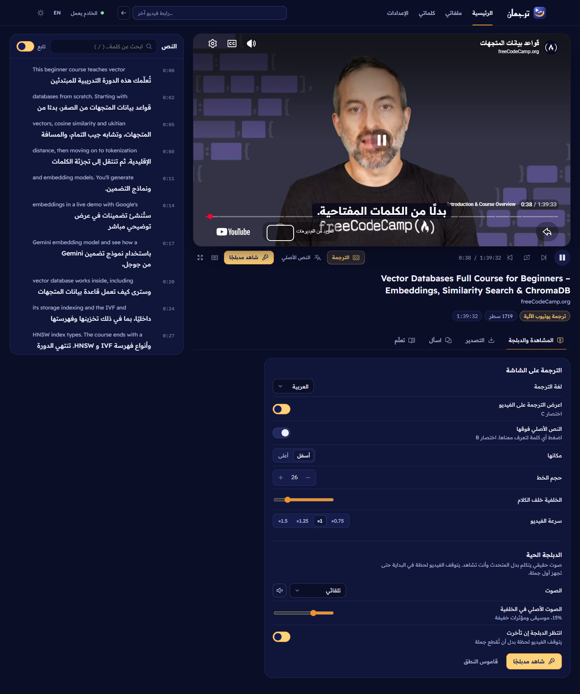
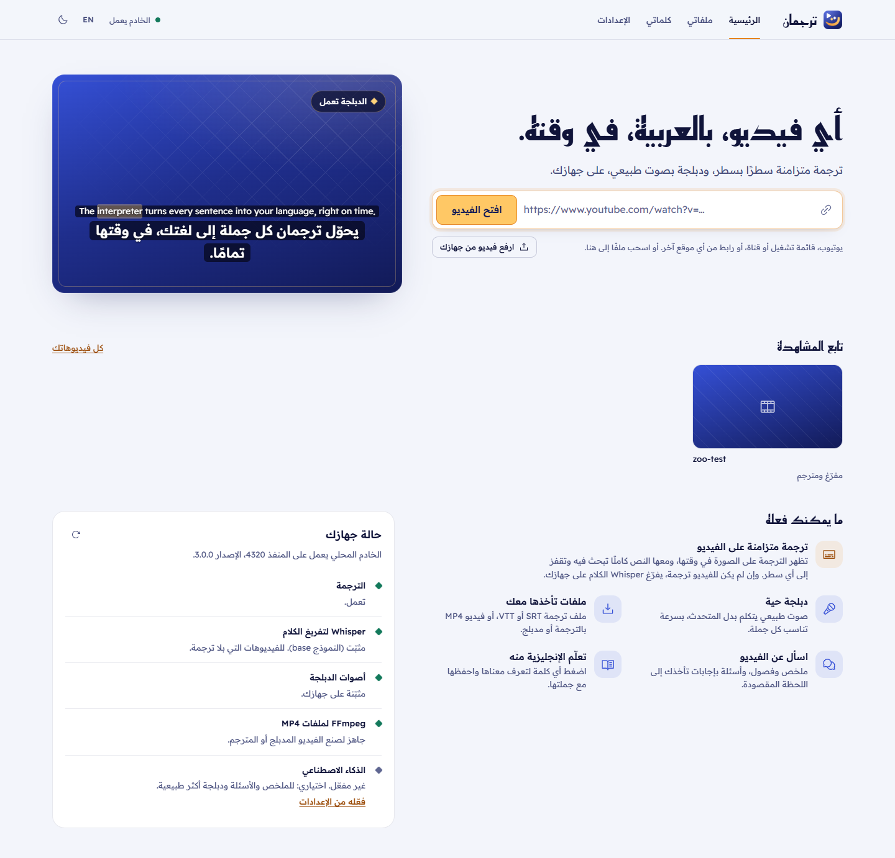
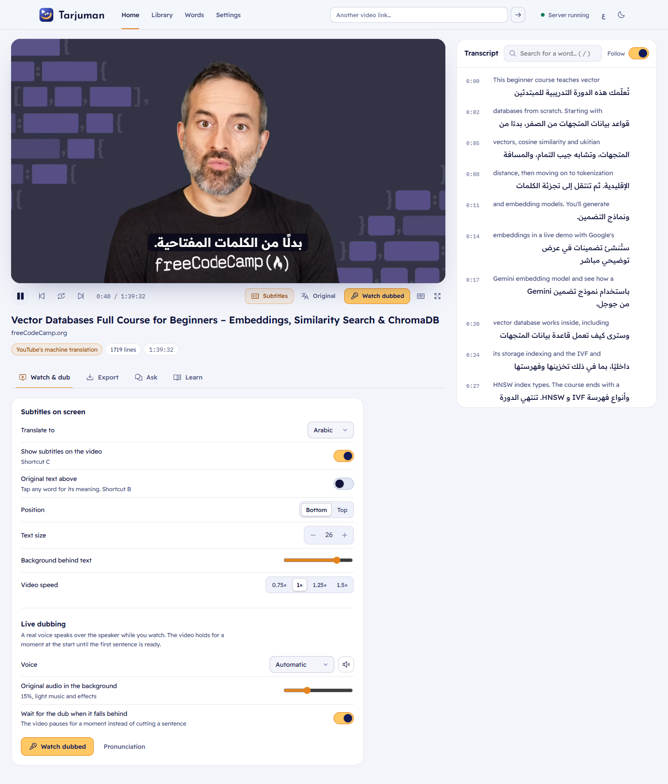
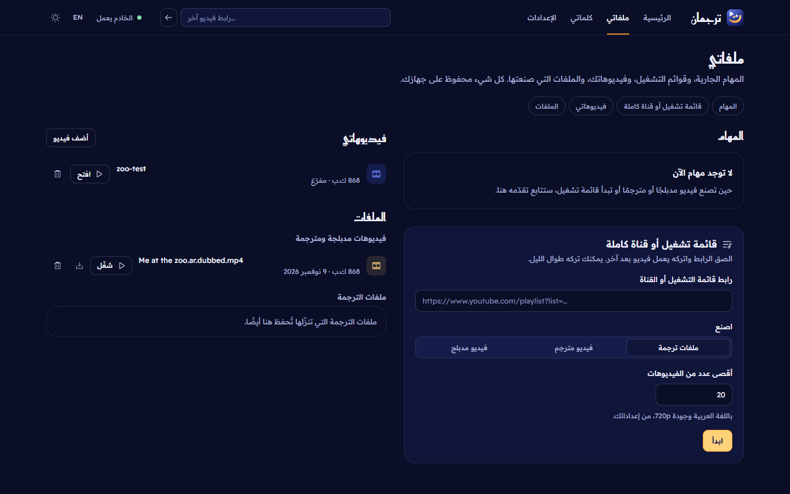
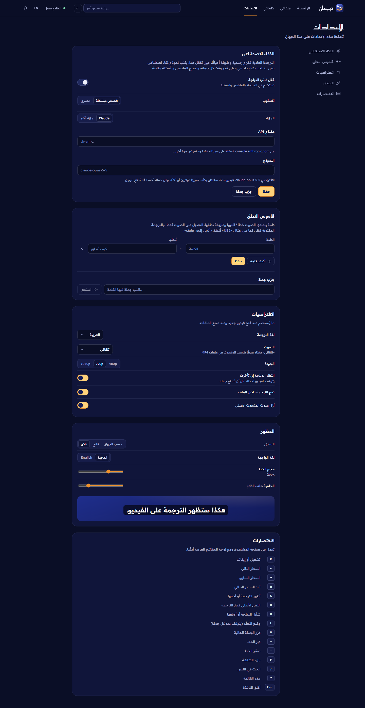
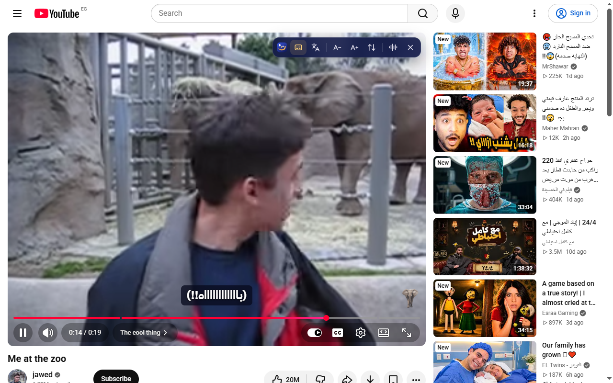
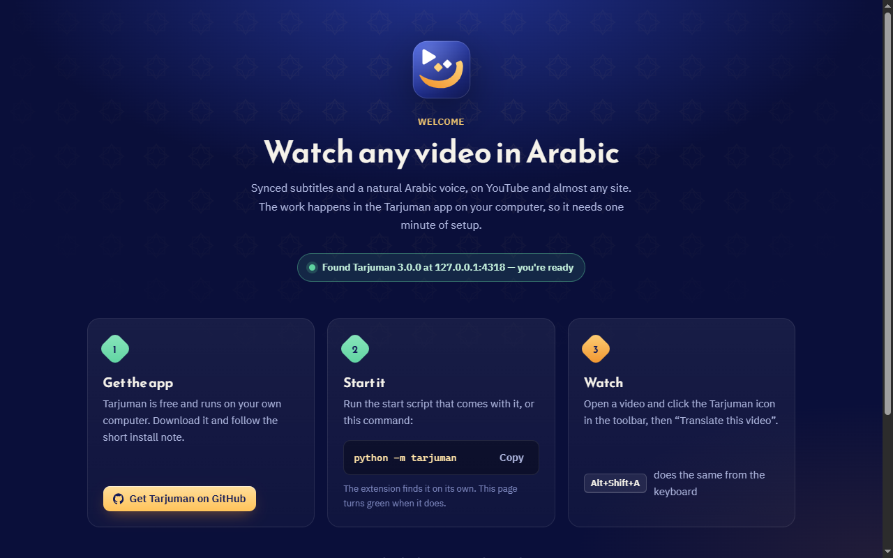
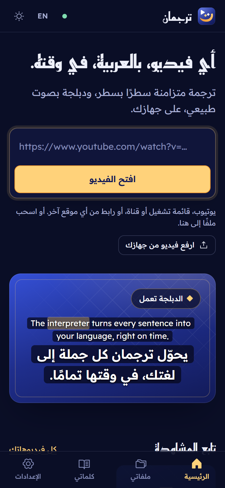
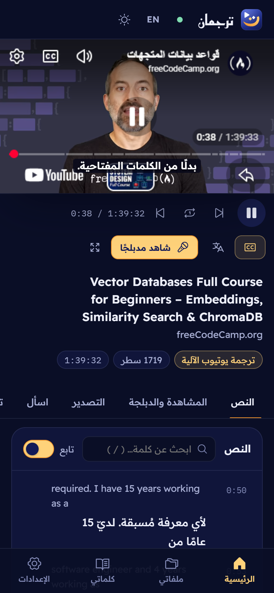
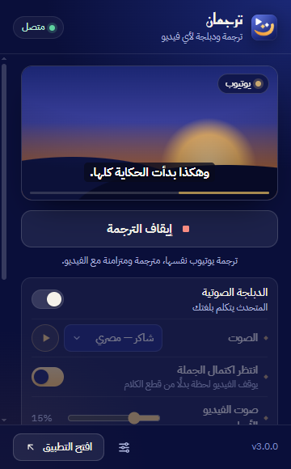

<p align="center">
  
</p>

<h1 align="center">Tarjuman · ترجمان</h1>

<p align="center">
  <strong>Regardez n'importe quelle vidéo en arabe.</strong><br>
  Traduction synchronisée, doublage en direct naturel, MP4 doublés et extension de navigateur. Tout tourne sur votre propre ordinateur.
</p>

<p align="center">
  <a href="../../LICENSE"></a>
  
  
  
</p>

<p align="center">
  <a href="../../README.md">English</a> ·
  <a href="README.ar.md">العربية</a> ·
  <b>Français</b> ·
  <a href="README.es.md">Español</a> ·
  <a href="README.de.md">Deutsch</a> ·
  <a href="README.it.md">Italiano</a> ·
  <a href="README.pt.md">Português</a> ·
  <a href="README.tr.md">Türkçe</a> ·
  <a href="README.ru.md">Русский</a> ·
  <a href="README.ur.md">اردو</a> ·
  <a href="README.fa.md">فارسی</a> ·
  <a href="README.hi.md">हिन्दी</a> ·
  <a href="README.id.md">Bahasa Indonesia</a> ·
  <a href="README.zh.md">中文</a> ·
  <a href="README.ja.md">日本語</a> ·
  <a href="README.ko.md">한국어</a>
</p>

<p align="center">
  
</p>

## Ce que fait Tarjuman

Collez un lien YouTube, importez une vidéo depuis votre ordinateur ou donnez-lui un lien provenant de presque n'importe quel site.

- **Sous-titres synchronisés.** Les sous-titres arabes s'affichent sur la vidéo ligne par ligne, avec la langue d'origine en dessous si vous le souhaitez. Les sous-titres générés automatiquement sont reconstitués en phrases complètes avant d'être traduits. Lorsqu'ils n'ont aucune ponctuation, ils sont découpés là où l'orateur marque réellement une pause, grâce au minutage mot par mot de YouTube.
- **Un doublage en direct qui sonne humain.** Une voix arabe neuronale prononce chaque phrase en rythme avec l'orateur, en arabe égyptien, saoudien, émirien, syrien, jordanien, libanais, marocain ou irakien. Aucune phrase n'est coupée ni sautée. Face à un orateur rapide, la vidéo ralentit légèrement le temps que la voix rattrape son retard, au lieu que la voix s'emballe ; ralentissez vous-même la vidéo et la voix profite de ce temps supplémentaire. Les mots qui s'écrivent de la même façon mais se lisent différemment sont prononcés selon le sens de la phrase (الجُمَل « les phrases », et non الجَمَل « le chameau »), d'après l'original anglais.
- **MP4 doublé.** Exportez la vidéo avec la voix off arabe. Tarjuman peut supprimer la voix de l'orateur d'origine tout en conservant la musique et les effets, attribuer à chaque intervenant une voix masculine ou féminine adaptée, et intégrer ou incruster les sous-titres.
- **Pas de sous-titres ? Aucun problème.** Whisper transcrit l'audio sur votre ordinateur, puis la transcription est traduite.
- **Fichiers de sous-titres.** Téléchargez du SRT, du VTT ou du texte brut, en arabe ou bilingue, ou un MP4 sous-titré prêt à partager.
- **Playlists entières.** Donnez-lui le lien d'une playlist ou d'une chaîne pour produire des sous-titres, des vidéos sous-titrées ou des vidéos doublées pour chacune de ses vidéos.
- **Interrogez la vidéo** (IA facultative). Obtenez un résumé, les points clés, des chapitres cliquables et des réponses qui vous amènent au moment où la vidéo traite votre question. Fonctionne avec Claude ou tout fournisseur compatible OpenAI (Gemini, Groq, OpenRouter, Ollama).
- **Apprenez l'anglais.** Touchez un mot pour voir sa signification, enregistrez-le avec sa phrase, révisez-le plus tard et exportez-le vers Anki. Vous pouvez aussi répéter une phrase, faire une pause après chaque ligne ou flouter les sous-titres pour vous tester.
- **Extension de navigateur.** Profitez des mêmes sous-titres et du même doublage directement sur YouTube, sur les sites dont le lecteur propose des sous-titres (Coursera, Udemy et d'autres), sur les sites de films et d'animes qui intègrent un lecteur hébergé sur un autre site, ou sur n'importe quel autre site en écoutant l'audio de l'onglet.
- **Sur votre téléphone.** Ouvrez l'application depuis n'importe quel téléphone connecté au même Wi-Fi.

D'autres langues fonctionnent aussi : le français, l'espagnol, l'allemand, le turc et l'anglais sont intégrés comme langues cibles.

## Captures d'écran

<table>
  <tr>
    <td width="50%"></td>
    <td width="50%"></td>
  </tr>
  <tr>
    <td></td>
    <td></td>
  </tr>
  <tr>
    <td></td>
    <td></td>
  </tr>
</table>

<p align="center">
  
  
</p>

## Démarrage rapide

Il vous faut **Python 3.11+** et **Node.js 20+**.

**Windows :** double-cliquez sur `start.cmd`. Si Windows vous demande s'il faut exécuter un script d'un éditeur inconnu, créez une fois pour toutes un raccourci sur le bureau avec `powershell -ExecutionPolicy Bypass -File scripts/create-shortcut.ps1` et lancez Tarjuman depuis ce raccourci : il exécute le même script via le `cmd.exe` de Windows, si bien que l'avertissement n'apparaît pas.

**macOS / Linux :**

```sh
./start.sh
```

Sous Debian, Ubuntu et Kali, installez d'abord `python3-venv` s'il manque (`sudo apt install python3-venv`).

Le premier lancement installe tout : les paquets Python, la voix arabe hors ligne et une version compilée de l'application web. L'application s'ouvre ensuite sur `http://127.0.0.1:4318`. Les fois suivantes, elle démarre en quelques secondes. Pour l'utiliser depuis votre téléphone, ouvrez l'adresse qu'elle affiche pour votre Wi-Fi. Sous Windows, si le téléphone n'arrive pas à s'y connecter, exécutez une fois `scripts/allow-phone.ps1` en tant qu'administrateur : il définit votre Wi-Fi domestique comme réseau privé et n'ouvre les ports de Tarjuman que sur les réseaux privés.

<details>
<summary>Installation manuelle</summary>

```sh
python -m venv .venv
.venv/bin/pip install -r backend/requirements.txt        # Windows: .venv\Scripts\pip
npm --prefix frontend install && npm --prefix frontend run build
PYTHONPATH=backend .venv/bin/python -m tarjuman           # Windows: set PYTHONPATH=backend
```

</details>

### Commandes

| Commande | Rôle |
|---|---|
| `python -m tarjuman` | Lance l'application (`--port`, `--host 127.0.0.1` pour cet ordinateur uniquement, `--no-open`) |
| `python -m tarjuman subs <link>` | Écrit les fichiers de sous-titres dans `data/output` (`--lang`, `--format srt,vtt,txt`) |
| `python -m tarjuman setup` | Installe ou répare tout |
| `python -m tarjuman update` | Met à jour yt-dlp et le client vocal, si les téléchargements ou les voix ne fonctionnent plus |
| `python -m tarjuman doctor` | Vérifie chaque composant |

## L'extension de navigateur

<p align="center">
  
</p>

1. Compilez-la une fois : `npm --prefix extension install && npm --prefix extension run build`.
2. Ouvrez `chrome://extensions` (ou `edge://extensions`), activez le **Mode développeur**, cliquez sur **Charger l'extension non empaquetée** et choisissez `extension/dist`.
3. Laissez l'application tourner, ouvrez une vidéo et cliquez sur l'icône Tarjuman, ou appuyez sur <kbd>Alt</kbd>+<kbd>Shift</kbd>+<kbd>A</kbd>.

L'extension communique uniquement avec l'application sur votre ordinateur. Son kit pour le Chrome Web Store (texte de la fiche, justification des autorisations, politique de confidentialité, images promotionnelles) se trouve dans [`extension/store`](../../extension/store).

## Comment le doublage reste synchronisé

Les lignes de sous-titres sont fusionnées en phrases complètes et les mots de remplissage sont supprimés. La vitesse de chaque phrase est ensuite choisie à partir d'une fenêtre d'anticipation d'environ 12 secondes : une phrase qui a de la marge prête du temps à une phrase chargée, et la vitesse change progressivement au lieu de sauter. Avant que le navigateur ne joue les premières phrases de chaque passage, le serveur les synthétise et les mesure, si bien que le plan repose sur des durées réelles et non sur des estimations, et il prépare le passage suivant en arrière-plan. Si le doublage prend tout de même du retard, la vidéo ralentit à 85 % de votre vitesse jusqu'à ce que la voix la rattrape, et ne se met en pause que lorsque l'écart dépasse environ deux secondes. Le rythme suit votre vitesse de lecture. Où que vous vous déplaciez dans la vidéo, le doublage reprend exactement au bon endroit. Lorsque les traducteurs gratuits limitent le nombre de requêtes, un second point d'accès Google, puis la traduction de YouTube elle-même, prennent le relais pour que le doublage continue.

La conception complète est décrite dans [docs/implementation.md](../implementation.md).

## Confidentialité

Tarjuman privilégie le local. Vos vidéos, sous-titres, mots enregistrés, réglages et clé d'API restent dans le dossier `data/` de votre ordinateur. L'application contacte YouTube (sous-titres et téléchargements), Google Translate et MyMemory (traduction), le service vocal Edge de Microsoft (synthèse vocale) et, uniquement si vous l'activez, le fournisseur d'IA de votre choix. Aucun compte, aucune statistique, aucun pistage. L'API refuse les requêtes provenant d'autres sites, et les réglages d'IA ne peuvent être modifiés que depuis l'ordinateur qui exécute l'application.

## Configuration

| Variable d'environnement | Valeur par défaut | Signification |
|---|---|---|
| `TARJUMAN_HOME` | dossier du projet | Emplacement de `data/` |
| `TARJUMAN_PORT` | `4318` | Premier port essayé (il passe au suivant si le port est occupé ; l'extension suit) |
| `TARJUMAN_HOST` | `0.0.0.0` | Utilisez `127.0.0.1` pour rendre l'application inaccessible depuis votre Wi-Fi |
| `TARJUMAN_WHISPER_MODEL` | `base` | `small` ou `medium` pour une transcription plus précise (plus lente) |
| `ANTHROPIC_API_KEY` | – | Utilisée pour Claude si aucune clé n'est enregistrée dans les réglages |

## Structure du projet

```
backend/     Python package `tarjuman` (FastAPI): captions, translation, voices, dubbing, AI, jobs
frontend/    Vue 3 + Vite + TypeScript web app
extension/   Chrome / Edge extension (Manifest V3, Vue + Vite) and its store kit
shared/      the live dub engine used by both the web app and the extension
assets/      brand (icon source and renders)
docs/        plan, specification, implementation notes, translated READMEs, screenshots
```

## Développement

```sh
# backend tests (offline)
cd backend && ../.venv/bin/python -m pytest      # Windows: ..\.venv\Scripts\python

# dub engine tests
npm test

# web app with hot reload (proxies the API to 127.0.0.1:4318)
npm --prefix frontend run dev

# extension: build, test, package a store zip
npm --prefix extension run build && npm --prefix extension test && npm --prefix extension run package
```

Lisez [docs/specs.md](../specs.md) avant de modifier une route de l'API : l'application web et l'extension en dépendent toutes les deux.

## Construit avec

[faster-whisper](https://github.com/SYSTRAN/faster-whisper) ·
[edge-tts](https://github.com/rany2/edge-tts) ·
[Piper](https://github.com/rhasspy/piper) ·
[yt-dlp](https://github.com/yt-dlp/yt-dlp) ·
[les modèles MDX-Net d'Ultimate Vocal Remover](https://github.com/TRvlvr/model_repo) ·
[FastAPI](https://fastapi.tiangolo.com) ·
[Vue](https://vuejs.org) ·
[Claude](https://www.anthropic.com/claude)

## Licence

[MIT](../../LICENSE). Le téléchargement de vidéos et de sous-titres est soumis aux conditions de chaque site. Utilisez Tarjuman pour des contenus que vous avez le droit de regarder et d'adapter.
