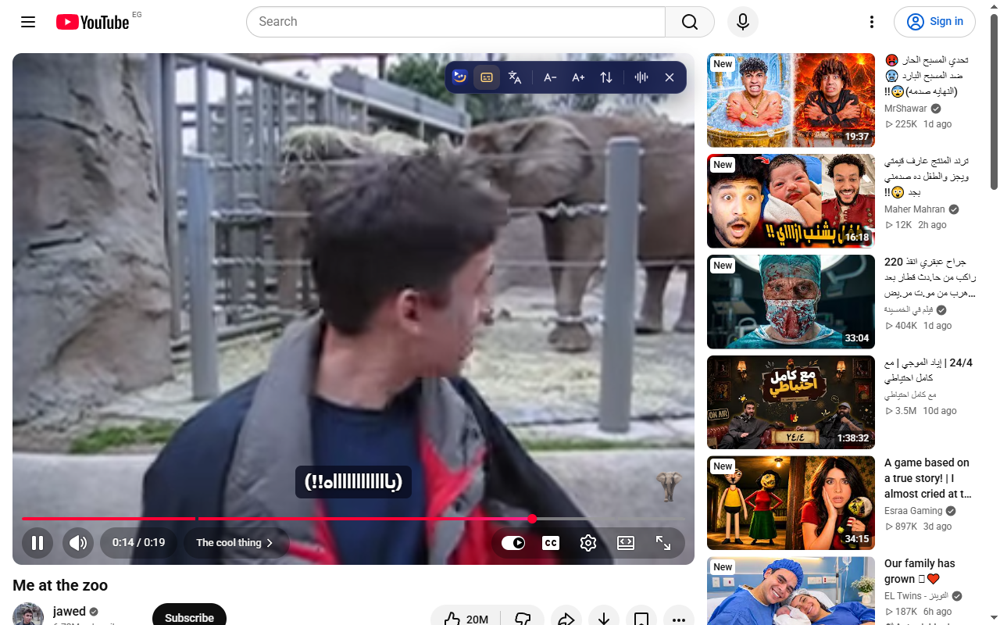
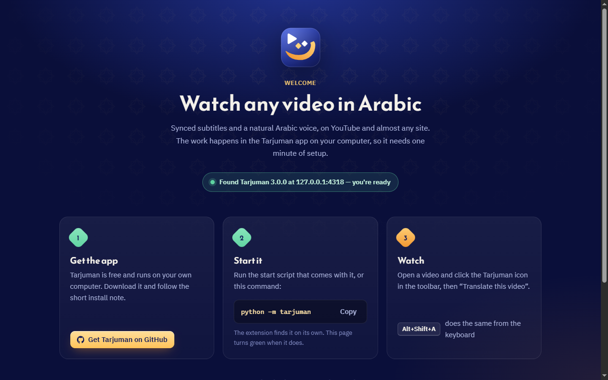

<p align="center">
  
</p>

<h1 align="center">Tarjuman · ترجمان</h1>

<p align="center">
  <strong>Tonton video apa pun dalam bahasa Arab.</strong><br>
  Terjemahan tersinkron, sulih suara langsung yang alami, MP4 bersulih suara, dan ekstensi browser. Semuanya berjalan di komputer Anda sendiri.
</p>

<p align="center">
  <a href="../../LICENSE"></a>
  
  
  
</p>

<p align="center">
  <a href="../../README.md">English</a> ·
  <a href="README.ar.md">العربية</a> ·
  <a href="README.fr.md">Français</a> ·
  <a href="README.es.md">Español</a> ·
  <a href="README.de.md">Deutsch</a> ·
  <a href="README.it.md">Italiano</a> ·
  <a href="README.pt.md">Português</a> ·
  <a href="README.tr.md">Türkçe</a> ·
  <a href="README.ru.md">Русский</a> ·
  <a href="README.ur.md">اردو</a> ·
  <a href="README.fa.md">فارسی</a> ·
  <a href="README.hi.md">हिन्दी</a> ·
  <b>Bahasa Indonesia</b> ·
  <a href="README.zh.md">中文</a> ·
  <a href="README.ja.md">日本語</a> ·
  <a href="README.ko.md">한국어</a>
</p>

<p align="center">
  
</p>

## Apa yang dilakukannya

Tempel tautan YouTube, unggah video atau berkas audio dari komputer Anda, rekam suara Anda sendiri, atau berikan tautan dari hampir situs mana pun.

- **Subtitle tersinkron.** Subtitle Arab muncul di video baris demi baris, dengan bahasa aslinya di bawah jika Anda mau. Teks otomatis disusun ulang menjadi kalimat utuh sebelum diterjemahkan. Jika sama sekali tidak ada tanda baca, teks dipotong di tempat pembicara benar-benar berhenti sejenak, berdasarkan waktu per kata dari YouTube.
- **Sulih suara langsung yang terdengar seperti manusia.** Suara Arab neural mengucapkan setiap kalimat seiring pembicara, dalam bahasa Arab Mesir, Saudi, Emirat, Suriah, Yordania, Lebanon, Maroko, atau Irak. Tidak ada kalimat yang terpotong atau terlewat. Jika pembicara bicara cepat, video sedikit diperlambat sampai suara menyusul, alih-alih suaranya yang terburu-buru; jika Anda sendiri memperlambat video, suara mendapat waktu tambahan itu. Kata yang tulisannya sama tetapi dibaca berbeda diucapkan sesuai makna kalimat (الجُمَل "kalimat-kalimat", bukan الجَمَل "unta"), ditentukan berdasarkan teks asli bahasa Inggris.
- **MP4 bersulih suara.** Ekspor video dengan sulih suara Arab. Tarjuman dapat menghapus suara pembicara asli sambil mempertahankan musik dan efek, memberi tiap pembicara suara pria atau wanita yang sesuai, serta menyematkan atau menempelkan subtitle secara permanen.
- **Tidak ada teks? Tidak masalah.** Whisper mentranskripsikan audio di komputer Anda, lalu transkripnya diterjemahkan. Pengaturan → Transkripsi memeriksa komputer Anda (memori, kartu grafis, prosesor), merekomendasikan model beserta alasannya, dan memungkinkan Anda memilih model yang berbeda untuk rekaman, untuk video, dan untuk mendengarkan langsung. Untuk ucapan bahasa Arab tersedia model yang dilatih dengan dialek-dialek (Mesir, Teluk, Syam, dan lainnya), yang dalam uji kami pada sebuah pesan suara berbahasa Mesir salah menulis jauh lebih sedikit kata daripada model standar. Anda bisa menambahkan daftar kata yang harus ditulis dengan benar (nama, produk, istilah bahasa Inggris yang diucapkan dalam bahasa Arab), beserta cara penulisan masing-masing, dan jika mau, membiarkan penyedia AI Anda mengoreksi transkripnya setelahnya. Model Whisper apa pun dalam format CTranslate2 dapat ditambahkan, dari Hugging Face atau dari folder di komputer Anda, dan model yang sudah diunduh dapat dihapus untuk mengosongkan ruang.
- **Berkas audio dan pesan suara.** Unggah MP3, M4A, WAV, OGG, Opus, FLAC, atau pesan suara WhatsApp, atau rekam langsung dari mikrofon Anda. Alih-alih video kosong, Anda mendapat gelombang suara yang bergerak dengan transkrip yang tersinkron, dan hasilnya dapat diekspor sebagai subtitle, M4A bersulih suara, atau video dengan gelombang suara dan subtitle permanen untuk dibagikan.
- **Berkas subtitle.** Unduh SRT, VTT, atau teks biasa, dalam bahasa Arab atau dwibahasa, atau MP4 bersubtitle yang siap dibagikan.
- **Seluruh playlist.** Berikan tautan playlist atau kanal untuk membuat subtitle, video bersubtitle, atau video bersulih suara bagi setiap video di dalamnya.
- **Tanya videonya** (AI opsional). Dapatkan ringkasan, poin-poin penting, bab yang dapat diklik, dan jawaban yang langsung melompat ke momen saat video membahas pertanyaan Anda. Bekerja dengan Claude atau penyedia apa pun yang kompatibel dengan OpenAI (Gemini, Groq, OpenRouter, Ollama).
- **Halaman tonton yang Anda kendalikan.** Transkrip di samping video menyorot setiap kata saat diucapkan, menandai pergantian pembicara dan suara seperti [musik], serta dapat dicari; klik baris mana pun untuk melompat ke sana. Bab dari pemilik video (atau dari ringkasan AI) menjadi judul bagiannya di transkrip dan ditandai di linimasa. Linimasa di bawah video menunjukkan letak baris-baris, cahaya lembut dalam warna video itu sendiri berpendar di belakang pemutar, dan mode bioskop (<kbd>T</kbd>) meredupkan semua yang lain. Masing-masing dapat dimatikan atau diatur di Pengaturan → Menonton. Keyboard: <kbd>→</kbd> baris berikutnya, <kbd>←</kbd> baris sebelumnya, <kbd>R</kbd> ulangi, <kbd>K</kbd> putar atau jeda, <kbd>?</kbd> untuk daftar lengkap (juga berfungsi dengan tata letak keyboard Arab).
- **Belajar bahasa Inggris.** Ketuk kata apa pun untuk melihat artinya, simpan beserta kalimatnya, ulangi nanti, dan ekspor ke Anki. Anda juga bisa mengulang kalimat, berhenti setelah tiap baris, atau mengaburkan subtitle untuk menguji diri sendiri.
- **Ekstensi browser.** Gunakan subtitle dan sulih suara yang sama langsung di YouTube, di video YouTube yang disematkan di situs lain, di situs yang pemutarnya punya teks (Coursera, Udemy, dan lainnya), di situs film dan anime yang menyematkan pemutarnya dari situs lain, atau di situs lain mana pun dengan mendengarkan audio tab. Di YouTube, ekstensi menambahkan transkrip di samping video, arti kata apa pun yang Anda klik, pintasan baris demi baris, dan tombol untuk melanjutkan di aplikasi.
- **Di ponsel Anda.** Buka aplikasi dari ponsel mana pun yang tersambung ke Wi-Fi yang sama.

Terjemahan dan sulih suara tersedia ke **74 bahasa**, masing-masing dengan suara penutur aslinya (bahasa Jepang terdengar Jepang, Hindi terdengar Hindi), dan semuanya bisa berjalan tanpa internet:

- **Terjemahan luring:** unduh model sebuah bahasa sekali saja (Pengaturan → Terjemahan luring) dan terjemahan berjalan di komputer Anda, saat Google tidak tersedia atau selalu.
- **Suara luring** dalam 31 bahasa yang melakukan sulih suara langsung di laptop biasa.
- **Paket suara**, dipasang hanya jika Anda menginginkannya: sulih suarakan MP4 dengan **suara pembicara aslinya sendiri** (eksperimental), atau dengan **suara dialek Arab** (Mesir, Irak, Maroko…) di komputer dengan kartu grafis yang mumpuni.

## Tangkapan layar

<table>
  <tr>
    <td width="50%"></td>
    <td width="50%"></td>
  </tr>
  <tr>
    <td></td>
    <td></td>
  </tr>
  <tr>
    <td></td>
    <td></td>
  </tr>
</table>

<p align="center">
  
  
</p>

## Mulai cepat

### Penginstal Windows

Unduh `Tarjuman-Setup-<version>.exe` dari halaman [Releases](https://github.com/MohamedElnagar94/tarjuman/releases) lalu jalankan. Penginstal ini membawa Python sendiri, semua paket, aplikasi web, dan ekstensi browser, jadi Anda tidak memerlukan Python maupun Node.js. Penginstal meminta hak administrator satu kali, memasang ke Program Files, dan tidak menyentuh firewall. Setelah itu Tarjuman terbuka di jendelanya sendiri, seperti aplikasi desktop lainnya, tanpa jendela konsol dan tanpa tab browser. Secara bawaan, menutup jendela itu menghentikannya; Pengaturan → Desktop dapat membuatnya tetap berada di area notifikasi, menjaga mesinnya tetap berjalan untuk ekstensi browser, dan menjalankannya bersama Windows. (Jendela tersebut adalah Microsoft Edge dalam mode aplikasi, yang ada di setiap Windows 10 dan 11; tidak ada tambahan yang dipasang.)

- Jika Setup langsung berhenti dengan pesan "unable to create the directory ...\Temp\is-*.tmp, access is denied", berkas penginstal berada di folder yang ditandai berintegritas rendah (beberapa alat sandbox menandai folder kerjanya seperti ini; `icacls <file>` lalu menampilkan `Low Mandatory Level`). Windows menjalankan berkas semacam itu dengan hak yang lebih sedikit. Salin ke folder lain, misalnya Downloads, lalu jalankan salinannya.
- Penginstal belum ditandatangani secara digital, jadi Windows SmartScreen mungkin menampilkan "penerbit tak dikenal": pilih *Info selengkapnya → Tetap jalankan*.
- Proses pertama mengunduh suara Arab luring (sekitar 60 MB) di latar belakang. Model Whisper terunduh sendiri saat pertama kali sebuah video memerlukannya.
- Pembaruan: Pengaturan → Pembaruan menampilkan apa yang ditambahkan dan diperbaiki versi baru, dan memasangnya dengan satu klik (atau dengan sendirinya, jika Anda mengaktifkannya).
- Video, subtitle, pengaturan, dan `.env` Anda disimpan di `%LOCALAPPDATA%\Tarjuman`, terpisah dari programnya. Pembaruan mempertahankannya; saat mencopot pemasangan, Anda ditanya apakah ingin menghapusnya.
- Menu Start memiliki pintasan ke folder ekstensi, untuk *Muat yang belum dibuka* di `chrome://extensions`.

Ada yang tidak berfungsi? Lihat [Pemecahan masalah](../troubleshooting.md). Perubahan di setiap versi ada di [Changelog](../../CHANGELOG.md).

### Linux (AppImage)

Unduh `Tarjuman-<version>-x86_64.AppImage` dari halaman [Releases](https://github.com/MohamedElnagar94/tarjuman/releases), jadikan dapat dieksekusi, lalu jalankan. Seperti penginstal Windows, berkas ini membawa Python sendiri, semua paket, aplikasi web, dan ekstensinya.

```sh
chmod +x Tarjuman-*-x86_64.AppImage
./Tarjuman-*-x86_64.AppImage
```

- Aplikasi terbuka di jendelanya sendiri jika Chrome, Chromium, atau Edge terpasang, dan di browser bawaan Anda jika tidak (dalam hal ini aplikasi terus berjalan sampai Anda keluar dari sesi, atau sampai `pkill -f "tarjuman app"`).
- Data Anda disimpan di `~/.local/share/Tarjuman`. Pengaturan → Pembaruan mengganti AppImage dengan versi yang lebih baru setelah memverifikasinya; mulai ulang Tarjuman untuk memakainya.
- Jika muncul pesan bahwa FUSE tidak ada (di beberapa distribusi, dan di WSL), jalankan dengan `--appimage-extract-and-run`, atau pasang `libfuse2`.
- Ikon area notifikasi dan pengaturan Desktop untuk saat ini hanya ada di Windows.

### Dari kode sumber

Anda memerlukan **Python 3.11+** dan **Node.js 20+**.

**Windows:** klik dua kali `start.cmd`. Jika Windows bertanya apakah akan menjalankan skrip dari penerbit tak dikenal, buat pintasan desktop sekali saja dengan `powershell -ExecutionPolicy Bypass -File scripts/create-shortcut.ps1` lalu jalankan Tarjuman dari pintasan itu; pintasan ini menjalankan skrip yang sama lewat `cmd.exe` bawaan Windows, sehingga pertanyaan itu tidak muncul.

**macOS / Linux:**

```sh
./start.sh
```

Di Debian, Ubuntu, dan Kali, pasang dulu `python3-venv` jika belum ada (`sudo apt install python3-venv`).

Proses pertama memasang semuanya: paket Python, suara Arab luring, dan build aplikasi web. Setelah itu aplikasi terbuka di `http://127.0.0.1:4318`. Pada proses berikutnya, aplikasi siap dalam beberapa detik. Untuk memakainya dari ponsel, buka alamat yang ditampilkannya untuk Wi-Fi Anda. Di Windows, jika ponsel tidak bisa menjangkaunya, jalankan `scripts/allow-phone.ps1` sekali sebagai administrator: skrip ini menandai Wi-Fi rumah Anda sebagai Private dan membuka port Tarjuman hanya di jaringan Private.

<details>
<summary>Penyiapan manual</summary>

```sh
python -m venv .venv
.venv/bin/pip install -r backend/requirements.txt        # Windows: .venv\Scripts\pip
npm --prefix frontend install && npm --prefix frontend run build
PYTHONPATH=backend .venv/bin/python -m tarjuman           # Windows: set PYTHONPATH=backend
```

</details>

### Perintah

| Perintah | Fungsinya |
|---|---|
| `python -m tarjuman` | Menjalankan aplikasi (`--port`, `--host 127.0.0.1` khusus komputer ini, `--no-open`) |
| `python -m tarjuman app` | Menjalankan aplikasi di jendelanya sendiri (Edge atau Chrome dalam mode aplikasi), bukan di tab browser; di Windows dengan ikon di area notifikasi (`--background` menjalankannya di sana tanpa jendela) |
| `python -m tarjuman subs <link>` | Menulis berkas subtitle ke `data/output` (`--lang`, `--format srt,vtt,txt`) |
| `python -m tarjuman setup` | Memasang atau memperbaiki semuanya |
| `python -m tarjuman update` | Memperbarui yt-dlp dan klien suara, jika unduhan atau suara berhenti berfungsi |
| `python -m tarjuman doctor` | Memeriksa setiap komponen |

## Ekstensi browser

<p align="center">
  
</p>

Pasang langsung dari [Chrome Web Store](https://chromewebstore.google.com/detail/gcfnomfbpenbhdebopmpdfamlaiodflp), atau bangun dari kode sumber dengan langkah berikut:

1. Build sekali: `npm --prefix extension install && npm --prefix extension run build`.
2. Buka `chrome://extensions` (atau `edge://extensions`), aktifkan **Mode developer**, klik **Muat yang belum dibuka**, lalu pilih `extension/dist`.
3. Biarkan aplikasi tetap berjalan, buka video, lalu klik ikon Tarjuman atau tekan <kbd>Alt</kbd>+<kbd>Shift</kbd>+<kbd>A</kbd>.
4. Halaman opsinya mengatur font subtitle, bahasa ekstensi (bahasa browser, Arab, atau Inggris), pintasan keyboard, dan apakah ekstensi mulai sendiri di YouTube (tidak pernah, selalu, atau hanya di kanal yang Anda pilih).

Selama menerjemahkan:

- **Transkrip di samping video** di YouTube: semua baris, dengan baris saat ini disorot; klik sebuah baris untuk melompat ke sana, atau cari.
- **Klik sebuah kata** di baris asli untuk melihat artinya, dan simpan ke *Kata saya* di aplikasi beserta kalimatnya.
- **Pintasan:** <kbd>Alt</kbd>+<kbd>→</kbd> baris berikutnya, <kbd>Alt</kbd>+<kbd>←</kbd> baris sebelumnya, <kbd>Alt</kbd>+<kbd>↓</kbd> ulangi, <kbd>Alt</kbd>+<kbd>S</kbd> subtitle, <kbd>Alt</kbd>+<kbd>V</kbd> sulih suara, <kbd>Alt</kbd>+<kbd>T</kbd> transkrip.
- **Waktu:** jika baris muncul sebelum atau sesudah ucapan, geser dengan <kbd>Alt</kbd>+<kbd>[</kbd> dan <kbd>Alt</kbd>+<kbd>]</kbd> (sulih suara ikut bergeser).
- **Buka di aplikasi** pada momen yang sama, untuk ekspor dan halaman tonton lengkap.
- Ekstensi tetap berfungsi di pemutar mini YouTube, mengikuti situs kursus ke pelajaran berikutnya, dan tetap menampilkan baris saat sebuah situs menampilkan videonya saja dalam layar penuh.

Jika Chrome menampilkan *Proceed with caution: this extension is not trusted by Enhanced Safe Browsing*, itu karena penerbitnya baru di Chrome Web Store: Chrome menampilkannya untuk setiap penerbit baru sampai ia mematuhi kebijakan toko selama beberapa bulan, dan hanya kepada yang mengaktifkan perlindungan yang ditingkatkan. Ekstensi ini lolos peninjauan toko dan [kode sumbernya](https://github.com/MohamedElnagar94/tarjuman/tree/main/extension) terbuka. Pilih *Continue to install*.

Ekstensi hanya berkomunikasi dengan aplikasi di komputer Anda. Kit Chrome Web Store-nya (teks listing, alasan izin, kebijakan privasi, gambar promosi) ada di [`extension/store`](../../extension/store).

## Cara sulih suara tetap sinkron

Baris teks digabung menjadi kalimat utuh dan kata pengisi dihapus. Kemudian kecepatan setiap kalimat dipilih berdasarkan jendela antisipasi sekitar 12 detik, sehingga kalimat yang longgar meminjamkan waktu kepada kalimat yang padat dan kecepatan berubah bertahap alih-alih melompat. Sebelum browser memutar kalimat-kalimat pertama di setiap bagian, server menyintesis dan mengukurnya, jadi rencananya didasarkan pada durasi nyata, bukan tebakan, dan server menyiapkan bagian berikutnya di latar belakang. Jika sulih suara tetap tertinggal, video melambat menjadi 85% dari kecepatan Anda sampai suara menyusul, dan hanya dijeda bila selisihnya melewati sekitar dua detik. Tempo mengikuti kecepatan putar Anda. Melompat ke titik mana pun akan melanjutkan sulih suara tepat di posisi itu. Saat penerjemah gratis membatasi jumlah permintaan, endpoint Google kedua lalu terjemahan milik YouTube sendiri menjaga sulih suara tetap berjalan.

Desain lengkapnya ada di [docs/implementation.md](../implementation.md).

## Privasi

Tarjuman mengutamakan pemrosesan lokal. Video, subtitle, kata tersimpan, pengaturan, dan kunci API Anda tetap berada di folder `data/` di komputer Anda. Aplikasi menghubungi YouTube (teks dan unduhan), Google Translate dan MyMemory (terjemahan), layanan suara Edge milik Microsoft (ucapan), dan, hanya jika Anda mengaktifkannya, penyedia AI pilihan Anda. Tidak ada akun, analitik, atau pelacakan. Video dan audio tidak pernah diunggah.

| Fitur | Yang keluar dari komputer Anda | Dikirim ke | Tanpa mengirim apa pun |
|---|---|---|---|
| Teks YouTube | Tautan video | YouTube | Unggah berkas; ditranskripsikan secara lokal |
| Terjemahan | Kalimat-kalimat video, sebagai teks | Google Translate, lalu MyMemory | Model terjemahan luring (Pengaturan → Terjemahan luring) |
| Suara sulih suara | Setiap kalimat terjemahan dan nama suara | Suara Microsoft Edge, lalu Google | Suara luring (Supertonic, 31 bahasa; Piper untuk bahasa Arab) dan paket suara |
| Unduhan video | Permintaan untuk video tersebut | Situs yang menampungnya | Berkas yang sudah ada di komputer Anda |
| AI (opsional, nonaktif secara bawaan) | Teks video dan pertanyaan Anda | Penyedia yang Anda pilih | Biarkan nonaktif, atau gunakan server lokal seperti Ollama |
| Unduhan model | Permintaan unduhan, satu kali | Hugging Face, GitHub, Universitas Helsinki (model terjemahan), PyTorch dan PyPI (paket suara) | Tidak ada setelah unduhan pertama |
| Pemeriksaan pembaruan | Permintaan daftar versi yang lebih baru, setiap beberapa jam | GitHub | Matikan "Periksa pembaruan secara otomatis" di Pengaturan → Pembaruan |
| Koreksi transkrip (opsional, nonaktif secara bawaan) | Teks transkrip | Penyedia AI yang Anda pilih | Biarkan nonaktif; daftar kata berfungsi tanpanya |
| Pengenalan ucapan, pemisahan musik, berkas dan rekaman Anda | Tidak ada | – | Selalu lokal |

Tabel yang sama ada di aplikasi, di Pengaturan → Privasi. API menolak permintaan dari situs web lain, dan pengaturan AI hanya dapat diubah dari komputer yang menjalankan aplikasi.

## Konfigurasi

Salin `.env.example` menjadi `.env` di folder proyek lalu sunting; setiap setelan dijelaskan di sana, dalam bahasa Arab dan Inggris. Berkas ini dibaca saat aplikasi dimulai, jadi mulai ulang Tarjuman setelah ada perubahan. Variabel yang disetel di lingkungan sebenarnya lebih diutamakan daripada berkas ini.

| Variabel lingkungan | Bawaan | Arti |
|---|---|---|
| `TARJUMAN_HOME` | folder proyek | Lokasi penyimpanan `data/` |
| `TARJUMAN_PORT` | `4318` | Port pertama yang dicoba (naik ke port berikutnya jika sibuk; ekstensi mengikutinya) |
| `TARJUMAN_HOST` | `0.0.0.0` | Gunakan `127.0.0.1` agar aplikasi tidak bisa diakses dari Wi-Fi Anda |
| `TARJUMAN_WHISPER_MODEL` | (kosong) | Dipilih di Pengaturan → Transkripsi, yang merekomendasikan model untuk komputer Anda; nilai di sini dipakai selama setelan itu berada pada Otomatis |
| `TARJUMAN_VOICE_CACHE_GB` | `2` | Batas ukuran suara dubbing yang disimpan; yang paling lama tidak dipakai dihapus lebih dulu |
| `TARJUMAN_MAX_UPLOAD_GB` | `8` | Ukuran video terbesar yang bisa kamu unggah |
| `TARJUMAN_PAIR_MINUTES` | `15` | Berapa lama kode penyandingan ponsel (QR) berlaku; `0` = sampai Anda membuat yang baru |
| `TARJUMAN_FETCH_PRIVATE` | nonaktif | Setel ke `1` untuk mengizinkan pengunduhan dari alamat di dalam jaringan Anda sendiri |
| `TARJUMAN_HEAVY_JOBS` | `2` | Berapa banyak tugas berat (Whisper, sulih suara, menempelkan subtitle) yang berjalan bersamaan; gunakan `1` di komputer dengan memori kecil |
| `TARJUMAN_MAX_QUEUE` | `20` | Jumlah tugas terbanyak yang boleh menunggu giliran |
| `TARJUMAN_FORCE_ASR` | nonaktif | Setel ke `1` agar selalu mentranskripsikan dengan Whisper, mengabaikan teks YouTube |
| `ANTHROPIC_API_KEY` | – | Dipakai untuk Claude jika tidak ada kunci yang tersimpan di pengaturan |

## Struktur proyek

```
backend/     Python package `tarjuman` (FastAPI): captions, translation, voices, dubbing, AI, jobs
frontend/    Vue 3 + Vite + TypeScript web app
extension/   Chrome / Edge extension (Manifest V3, Vue + Vite) and its store kit
shared/      the live dub engine used by both the web app and the extension
assets/      brand (icon source and renders)
docs/        plan, specification, implementation notes, translated READMEs, screenshots
```

## Pengembangan

```sh
# backend tests (offline)
cd backend && ../.venv/bin/python -m pytest      # Windows: ..\.venv\Scripts\python

# dub engine tests
npm test

# web app with hot reload (proxies the API to 127.0.0.1:4318)
npm --prefix frontend run dev

# extension: build, test, package a store zip
npm --prefix extension run build && npm --prefix extension test && npm --prefix extension run package
```

Baca [docs/specs.md](../specs.md) sebelum mengubah rute API: aplikasi web dan ekstensi sama-sama bergantung padanya.

### Membuat penginstal Windows

```powershell
powershell -ExecutionPolicy Bypass -File installer\build.ps1   # build\windows\app: Python, packages, web app, extension
iscc /DAppVersion=3.0.0 installer\tarjuman.iss                # build\windows\Tarjuman-Setup-3.0.0.exe (Inno Setup 6)
```

Workflow *Windows installer* melakukan hal yang sama di GitHub: jalankan dari tab Actions, atau dorong tag seperti `v3.0.0` untuk melampirkan penginstal ke sebuah rilis. Sebelum mengompilasi, workflow ini menjalankan aplikasi yang dibundel dan memeriksa bahwa aplikasi itu merespons.

### Membuat AppImage Linux

```sh
installer/linux/build.sh   # build/linux/Tarjuman-<version>-x86_64.AppImage (needs curl, python3, Node.js 20+)
```

AppImage ini membundel Python yang dapat dipindahkan (relocatable) dari python-build-standalone. Workflow yang sama membuatnya di samping penginstal Windows dan menerbitkan keduanya pada tag `v*`.

## Dibangun dengan

[faster-whisper](https://github.com/SYSTRAN/faster-whisper) ·
[edge-tts](https://github.com/rany2/edge-tts) ·
[Piper](https://github.com/rhasspy/piper) ·
[yt-dlp](https://github.com/yt-dlp/yt-dlp) ·
[model MDX-Net dari Ultimate Vocal Remover](https://github.com/TRvlvr/model_repo) ·
[FastAPI](https://fastapi.tiangolo.com) ·
[Vue](https://vuejs.org) ·
[Claude](https://www.anthropic.com/claude)

## Lisensi

[MIT](../../LICENSE). Mengunduh video dan teks tunduk pada ketentuan masing-masing situs. Gunakan Tarjuman untuk konten yang boleh Anda tonton dan adaptasi.
