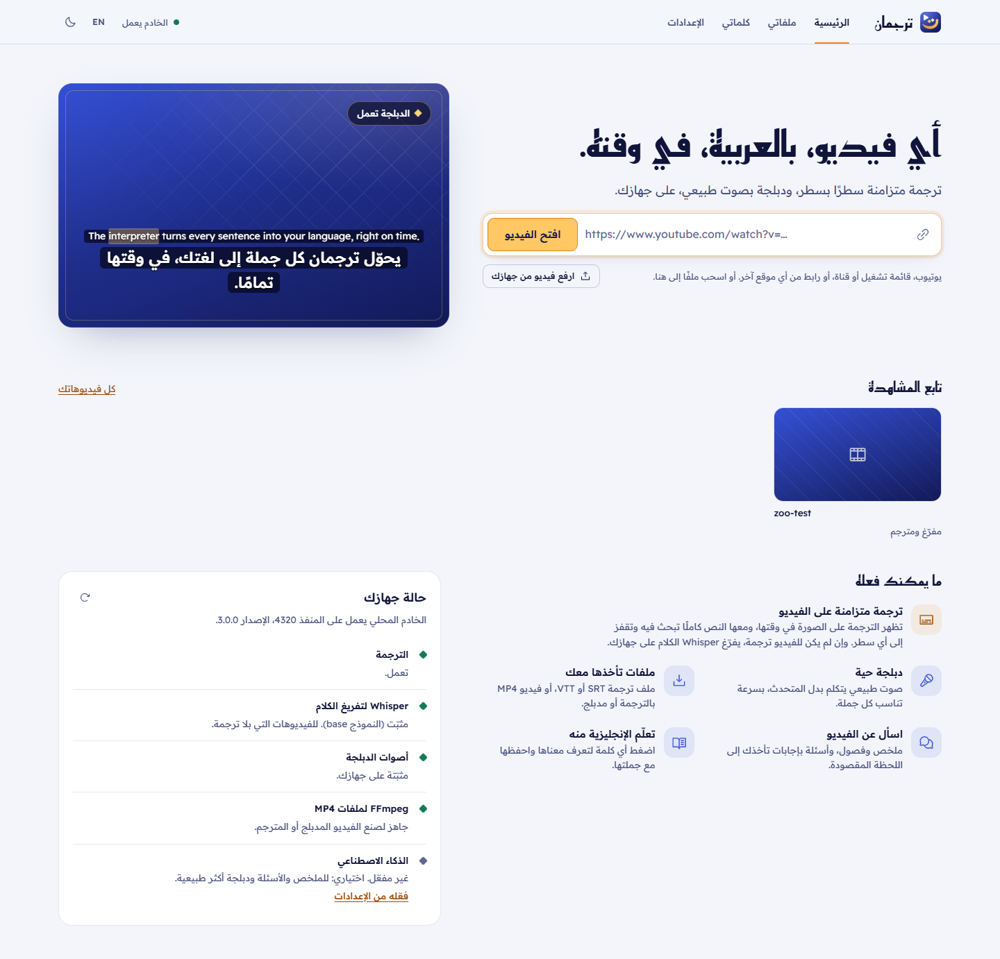

<p align="center">
  
</p>

<h1 align="center">Tarjuman · ترجمان</h1>

<p align="center">
  <strong>どんな動画もアラビア語で。</strong><br>
  同期翻訳、自然なライブ吹き替え、吹き替え済み MP4、そしてブラウザ拡張機能。すべてあなたのパソコン上で動きます。
</p>

<p align="center">
  <a href="../../LICENSE"></a>
  
  
  
</p>

<p align="center">
  <a href="../../README.md">English</a> ·
  <a href="README.ar.md">العربية</a> ·
  <a href="README.fr.md">Français</a> ·
  <a href="README.es.md">Español</a> ·
  <a href="README.de.md">Deutsch</a> ·
  <a href="README.it.md">Italiano</a> ·
  <a href="README.pt.md">Português</a> ·
  <a href="README.tr.md">Türkçe</a> ·
  <a href="README.ru.md">Русский</a> ·
  <a href="README.ur.md">اردو</a> ·
  <a href="README.fa.md">فارسی</a> ·
  <a href="README.hi.md">हिन्दी</a> ·
  <a href="README.id.md">Bahasa Indonesia</a> ·
  <a href="README.zh.md">中文</a> ·
  <b>日本語</b> ·
  <a href="README.ko.md">한국어</a>
</p>

<p align="center">
  
</p>

## できること

YouTube のリンクを貼り付けるか、パソコンから動画や音声ファイルをアップロードするか、自分の声を録音するか、ほぼどのサイトのリンクでも渡すだけです。

- **同期字幕。** アラビア語の字幕が動画の上に一行ずつ表示され、必要なら元の言語をその下に表示できます。自動生成字幕は、翻訳の前に完全な文へと組み立て直されます。句読点がまったくない場合は、YouTube の単語ごとのタイミングを使って、話し手が実際に間を置くところで区切ります。
- **人の声のように聞こえるライブ吹き替え。** ニューラル音声のアラビア語が、話し手のタイミングに合わせて一文ずつ読み上げます。エジプト、サウジアラビア、アラブ首長国連邦、シリア、ヨルダン、レバノン、モロッコ、イラクのアラビア語に対応しています。文が途中で切れたり飛ばされたりすることはありません。話し手が早口のときは、音声を急がせるのではなく、音声が追いつくまで動画を少しだけ遅くします。自分で動画を遅くすれば、その分の時間が音声に回ります。綴りが同じで読み方が違う語は、英語の原文をもとに文の意味どおりに読みます（الجَمَل「ラクダ」ではなく الجُمَل「文」）。
- **吹き替え MP4。** アラビア語のボイスオーバー付きで動画を書き出せます。音楽や効果音を残したまま元の話し手の声を取り除いたり、話し手ごとに合った男性または女性の声を割り当てたり、字幕を埋め込んだり焼き込んだりできます。
- **字幕がなくても大丈夫。** Whisper がパソコン上で音声を文字起こしし、その文字起こしを翻訳します。「設定 → 文字起こし」はパソコン（メモリ、グラフィックカード、プロセッサー）を調べてモデルを推奨し、その理由を説明します。録音用、動画用、ライブ聞き取り用にそれぞれ別のモデルを選ぶこともできます。アラビア語の音声には方言（エジプト、湾岸、レバントなど）で学習したモデルがあり、エジプト方言のボイスメモを使った私たちのテストでは、標準のモデルより単語の誤りがはるかに少なくなりました。正しく書き起こしてほしい単語（人名、製品名、アラビア語の中で話される英語の用語など）のリストを、それぞれの正しい表記とともに追加でき、必要なら AI プロバイダーに文字起こしを後から修正させることもできます。CTranslate2 形式の Whisper モデルであれば、Hugging Face からでもパソコン上のフォルダからでも追加でき、ダウンロードしたモデルは削除して空き容量を確保できます。
- **音声ファイルとボイスメモ。** MP3、M4A、WAV、OGG、Opus、FLAC、または WhatsApp のボイスメモをアップロードするか、マイクから直接録音できます。何も映らない動画の代わりに動く波形が表示され、文字起こしも同期します。字幕、吹き替え済みの M4A、または波形と焼き込み字幕の入った共有用の動画として書き出せます。
- **字幕ファイル。** SRT、VTT、プレーンテキストを、アラビア語のみまたは二言語でダウンロードできます。そのまま共有できる字幕付き MP4 も作れます。
- **プレイリストまるごと。** プレイリストやチャンネルのリンクを渡せば、含まれるすべての動画について字幕、字幕付き動画、吹き替え動画を作成します。
- **動画に質問する**（AI はオプション）。要約、要点、クリックできるチャプター、そして質問の内容が語られている場面へジャンプできる回答が得られます。Claude、または OpenAI 互換の任意のプロバイダー（Gemini、Groq、OpenRouter、Ollama）で動作します。
- **自分好みに調整できる視聴ページ。** 動画の横の文字起こしでは、話されている単語が順に強調表示され、話し手の交代や [music] のような音が示され、検索もできます。どの行をクリックしてもその位置へジャンプします。動画の投稿者によるチャプター（または AI の要約によるチャプター）が文字起こしの該当部分の見出しになり、タイムラインにも印が付きます。動画の下のタイムラインには行のある位置が表示され、プレーヤーの背後には動画自体の色を使ったやわらかな光が広がり、シネマモード（<kbd>T</kbd>）ではそれ以外のすべてが暗くなります。これらはどれも「設定 → 視聴」でオフにしたり調整したりできます。キーボード：<kbd>→</kbd> 次の行、<kbd>←</kbd> 前の行、<kbd>R</kbd> 繰り返し、<kbd>K</kbd> 再生／一時停止、<kbd>?</kbd> ですべてのショートカットを表示（アラビア語のキーボード配列でも動作します）。
- **英語を学ぶ。** 単語をタップすると意味が表示され、その文ごと保存して後で復習し、Anki に書き出せます。文を繰り返したり、一行ごとに一時停止したり、字幕をぼかして自分を試したりもできます。
- **ブラウザ拡張機能。** 同じ字幕と吹き替えを、YouTube 上で直接、他のサイトに埋め込まれた YouTube 動画で、プレーヤーに字幕があるサイト（Coursera、Udemy など）で、別のサイトのプレーヤーを埋め込んでいる映画やアニメのサイトで、あるいはタブの音声を聞き取ることでその他のどのサイトでも使えます。YouTube では、動画の横の文字起こし、クリックした単語の意味、一行ずつ移動するショートカット、そしてアプリで続きを見るためのボタンが追加されます。
- **スマートフォンで。** 同じ Wi-Fi につながっているスマートフォンなら、どれからでもアプリを開けます。

**74 の言語**に翻訳・吹き替えでき、それぞれにネイティブの音声があります（日本語は日本語らしく、ヒンディー語はヒンディー語らしく聞こえます）。しかも、すべてインターネットなしで動かせます。

- **オフライン翻訳：** 言語のモデルを一度ダウンロードすれば（設定 → オフライン翻訳）、Google が使えないとき、あるいは常に、翻訳がパソコン上で実行されます。
- **オフライン音声**は 31 言語に対応し、一般的なノートパソコンでもライブ吹き替えができます。
- **ボイスパック**（必要な場合にだけインストール）：MP4 を**元の話し手自身の声**で吹き替えたり（実験的機能）、高性能なグラフィックカードを搭載したパソコンでは**アラビア語方言の音声**（エジプト、イラク、モロッコ…）で吹き替えたりできます。

## スクリーンショット

<table>
  <tr>
    <td width="50%"></td>
    <td width="50%"></td>
  </tr>
  <tr>
    <td></td>
    <td></td>
  </tr>
  <tr>
    <td></td>
    <td></td>
  </tr>
</table>

<p align="center">
  
  
</p>

## クイックスタート

### Windows インストーラー

[Releases](https://github.com/MohamedElnagar94/tarjuman/releases) ページから `Tarjuman-Setup-<version>.exe` をダウンロードして実行します。専用の Python、すべてのパッケージ、Web アプリ、ブラウザ拡張機能が同梱されているので、Python も Node.js も不要です。管理者権限を一度だけ求め、Program Files にインストールし、ファイアウォールには手を加えません。その後 Tarjuman は、ほかのデスクトップアプリと同じように専用のウィンドウで開きます。コンソールウィンドウもブラウザのタブも表示されません。既定ではウィンドウを閉じるとアプリも終了しますが、「設定 → デスクトップ」で、代わりに通知領域に残す、ブラウザ拡張機能のためにエンジンを動かし続ける、Windows と同時に起動する、といった設定ができます。（このウィンドウはアプリモードの Microsoft Edge で、Windows 10 と 11 には必ず入っています。追加で何かがインストールされることはありません。）

- セットアップが「unable to create the directory ...\Temp\is-*.tmp, access is denied」と表示してすぐに止まる場合は、インストーラーのファイルが低整合性とマークされたフォルダにあります（一部のサンドボックスツールは作業フォルダをこのようにマークします。その場合、`icacls <file>` に `Low Mandatory Level` と表示されます）。Windows はそのようなファイルを低い権限で実行します。ダウンロードフォルダなど別のフォルダにコピーして、そのコピーを実行してください。
- インストーラーにはまだコード署名がないため、Windows SmartScreen が「発行元不明」と表示することがあります。*詳細情報 → 実行* を選んでください。
- 初回起動時に、オフラインのアラビア語音声（約 60 MB）がバックグラウンドでダウンロードされます。Whisper のモデルは、動画で初めて必要になったときに自動でダウンロードされます。
- アップデート：「設定 → アップデート」で新しいバージョンの追加機能と修正内容を確認でき、ワンクリックでインストールできます（オンにすれば自動でインストールされます）。
- 動画、字幕、設定、`.env` は、プログラムとは別の `%LOCALAPPDATA%\Tarjuman` に保存されます。アップデートしてもそのまま残り、アンインストール時には削除するかどうかを尋ねられます。
- スタートメニューには拡張機能フォルダへのショートカットがあり、`chrome://extensions` の *パッケージ化されていない拡張機能を読み込む* で使えます。

うまく動かないときは[トラブルシューティング](../troubleshooting.md)を参照してください。各バージョンの変更点は [Changelog](../../CHANGELOG.md) にあります。

### Linux (AppImage)

[Releases](https://github.com/MohamedElnagar94/tarjuman/releases) ページから `Tarjuman-<version>-x86_64.AppImage` をダウンロードし、実行可能にしてから実行します。Windows インストーラーと同じく、専用の Python、すべてのパッケージ、Web アプリ、拡張機能が同梱されています。

```sh
chmod +x Tarjuman-*-x86_64.AppImage
./Tarjuman-*-x86_64.AppImage
```

- Chrome、Chromium、Edge のいずれかがインストールされていれば専用のウィンドウで開き、そうでなければ既定のブラウザで開きます（その場合は、ログアウトするか `pkill -f "tarjuman app"` を実行するまで動き続けます）。
- データは `~/.local/share/Tarjuman` に保存されます。「設定 → アップデート」は新しい AppImage を検証したうえで現在のものと置き換えます。新しいバージョンを使うには Tarjuman を再起動してください。
- FUSE がないと表示される場合（一部のディストリビューションや WSL）は、`--appimage-extract-and-run` を付けて実行するか、`libfuse2` をインストールしてください。
- 通知領域のアイコンと「デスクトップ」の設定は、現時点では Windows 専用です。

### ソースから

**Python 3.11+** と **Node.js 20+** が必要です。

**Windows：** `start.cmd` をダブルクリックします。発行元不明のスクリプトを実行するか Windows に尋ねられた場合は、`powershell -ExecutionPolicy Bypass -File scripts/create-shortcut.ps1` でデスクトップのショートカットを一度だけ作成し、そこから Tarjuman を起動してください。同じスクリプトを Windows 標準の `cmd.exe` 経由で実行するので、確認は表示されません。

**macOS / Linux：**

```sh
./start.sh
```

Debian、Ubuntu、Kali では、`python3-venv` がなければ先にインストールしてください（`sudo apt install python3-venv`）。

初回の実行ですべてがインストールされます。Python パッケージ、オフラインのアラビア語音声、そして Web アプリのビルドです。その後、アプリが `http://127.0.0.1:4318` で開きます。2 回目以降は数秒で起動します。スマートフォンから使うには、Wi-Fi 用に表示されるアドレスを開いてください。Windows でスマートフォンから接続できない場合は、`scripts/allow-phone.ps1` を管理者として一度実行してください。自宅の Wi-Fi をプライベートネットワークに設定し、Tarjuman のポートをプライベートネットワークでのみ開きます。

<details>
<summary>手動セットアップ</summary>

```sh
python -m venv .venv
.venv/bin/pip install -r backend/requirements.txt        # Windows: .venv\Scripts\pip
npm --prefix frontend install && npm --prefix frontend run build
PYTHONPATH=backend .venv/bin/python -m tarjuman           # Windows: set PYTHONPATH=backend
```

</details>

### コマンド

| コマンド | 内容 |
|---|---|
| `python -m tarjuman` | アプリを起動（`--port`、このパソコンからのみ使う場合は `--host 127.0.0.1`、`--no-open`） |
| `python -m tarjuman app` | ブラウザのタブではなく専用のウィンドウ（アプリモードの Edge または Chrome）でアプリを起動。Windows では通知領域のアイコンも表示（`--background` を付けるとウィンドウを開かずに通知領域で起動） |
| `python -m tarjuman subs <link>` | 字幕ファイルを `data/output` に書き出す（`--lang`、`--format srt,vtt,txt`） |
| `python -m tarjuman setup` | すべてをインストールまたは修復 |
| `python -m tarjuman update` | ダウンロードや音声が動かなくなったときに yt-dlp と音声クライアントを更新 |
| `python -m tarjuman doctor` | すべてのコンポーネントをチェック |

## ブラウザ拡張機能

<p align="center">
  
</p>

[Chrome ウェブストア](https://chromewebstore.google.com/detail/gcfnomfbpenbhdebopmpdfamlaiodflp) から直接インストールできます。ソースからビルドする場合は次の手順です。

1. 一度だけビルドします：`npm --prefix extension install && npm --prefix extension run build`。
2. `chrome://extensions`（または `edge://extensions`）を開き、**デベロッパー モード**をオンにして、**パッケージ化されていない拡張機能を読み込む**をクリックし、`extension/dist` を選びます。
3. アプリを起動したまま動画を開き、Tarjuman のアイコンをクリックするか、<kbd>Alt</kbd>+<kbd>Shift</kbd>+<kbd>A</kbd> を押します。
4. オプションページでは、字幕のフォント、拡張機能の言語（ブラウザと同じ、アラビア語、英語）、キーボードショートカット、YouTube で自動的に開始するかどうか（しない、常にする、選んだチャンネルでのみ）を設定できます。

Chrome に *Proceed with caution: this extension is not trusted by Enhanced Safe Browsing* と表示された場合、それは公開者が Chrome ウェブストアに新しく参加したためです。Chrome は新しい公開者がストアのポリシーを数か月守るまでこの表示を出し、保護強化機能を有効にしている人にだけ表示します。拡張機能はストアの審査を通過しており、[ソースコード](https://github.com/MohamedElnagar94/tarjuman/tree/main/extension) は公開されています。*Continue to install* を選んでください。

翻訳中は次のことができます。

- YouTube では**動画の横に文字起こし**：すべての行が表示され、現在の行が強調表示されます。行をクリックするとその位置へジャンプでき、検索もできます。
- 原文の行で**単語をクリック**すると意味が表示され、その文ごとアプリの *マイ単語* に保存できます。
- **ショートカット：** <kbd>Alt</kbd>+<kbd>→</kbd> 次の行、<kbd>Alt</kbd>+<kbd>←</kbd> 前の行、<kbd>Alt</kbd>+<kbd>↓</kbd> 繰り返し、<kbd>Alt</kbd>+<kbd>S</kbd> 字幕、<kbd>Alt</kbd>+<kbd>V</kbd> 吹き替え、<kbd>Alt</kbd>+<kbd>T</kbd> 文字起こし。
- **タイミング：** 行が音声より早く、または遅く表示される場合は、<kbd>Alt</kbd>+<kbd>[</kbd> と <kbd>Alt</kbd>+<kbd>]</kbd> でずらせます（吹き替えも一緒に動きます）。
- 同じ場面から**アプリで開く**：書き出しや完全な視聴ページを使えます。
- YouTube のミニプレーヤーでも動作し続け、講座サイトでは次のレッスンにも付いていき、サイトが動画だけを全画面表示にしても字幕の行を表示し続けます。

拡張機能はあなたのパソコン上のアプリとだけ通信します。Chrome Web Store 用のキット（掲載文、権限の説明、プライバシーポリシー、プロモーション画像）は [`extension/store`](../../extension/store) にあります。

## 吹き替えが同期を保つしくみ

字幕の行は完全な文にまとめられ、話し言葉のつなぎ言葉は取り除かれます。次に、約 12 秒の先読みウィンドウをもとに各文の速度を決めます。余裕のある文が詰まった文に時間を貸し、速度は急に跳ねずに少しずつ変わります。ブラウザが各区間の最初の数文を再生する前に、サーバーがそれらを合成して長さを測るので、計画は推測ではなく実際の長さに基づいています。次の区間はバックグラウンドで準備されます。それでも吹き替えが遅れた場合は、音声が追いつくまで動画を再生速度の 85% に落とします。動画が一時停止するのは、ずれが約 2 秒を超えたときだけです。ペースは再生速度に合わせて調整されます。どこにシークしても、吹き替えはその位置から正確に再開します。無料の翻訳サービスがレート制限をかけたときは、2 つ目の Google エンドポイント、さらに YouTube 自身の翻訳を使って吹き替えを続けます。

詳しい設計は [docs/implementation.md](../implementation.md) にあります。

## プライバシー

Tarjuman はローカルファーストです。動画、字幕、保存した単語、設定、API キーは、あなたのパソコンの `data/` フォルダに保存されます。アプリが接続するのは YouTube（字幕とダウンロード）、Google Translate と MyMemory（翻訳）、Microsoft の Edge 音声サービス（音声合成）、そして有効にした場合に限り、あなたが選んだ AI プロバイダーです。アカウント、アクセス解析、トラッキングは一切ありません。動画や音声がアップロードされることはありません。

| 機能 | パソコンの外に出るもの | 送信先 | 何も送信しない方法 |
|---|---|---|---|
| YouTube の字幕 | 動画のリンク | YouTube | ファイルをアップロードする（ローカルで文字起こしされます） |
| 翻訳 | 動画の文（テキストとして） | Google Translate、次に MyMemory | オフライン翻訳モデル（設定 → オフライン翻訳） |
| 吹き替え音声 | 翻訳された各文と音声の名前 | Microsoft Edge の音声、次に Google | オフライン音声（Supertonic は 31 言語、アラビア語は Piper）とボイスパック |
| 動画のダウンロード | 動画へのリクエスト | 動画をホストしているサイト | すでにパソコンにあるファイル |
| AI（オプション、既定ではオフ） | 動画のテキストとあなたの質問 | あなたが選んだプロバイダー | オフのままにするか、Ollama などのローカルサーバーを使う |
| モデルのダウンロード | ダウンロードのリクエスト（一度だけ） | Hugging Face、GitHub、ヘルシンキ大学（翻訳モデル）、PyTorch と PyPI（ボイスパック） | 初回のダウンロード後は何も送信されません |
| アップデートの確認 | 新しいバージョンの一覧へのリクエスト（数時間ごと） | GitHub | 「設定 → アップデート」で「アップデートを自動的に確認する」をオフにする |
| 文字起こしの修正（オプション、既定ではオフ） | 文字起こしのテキスト | あなたが選んだ AI プロバイダー | オフのままにする。単語リストはこれなしでも機能します |
| 音声認識、音楽の分離、あなたのファイルと録音 | なし | – | 常にローカル |

同じ表はアプリの「設定 → プライバシー」にもあります。API は他の Web サイトからのリクエストを拒否し、AI の設定はアプリを実行しているパソコンからしか変更できません。

## 設定

プロジェクトフォルダで `.env.example` を `.env` にコピーして編集してください。各設定の説明は、そのファイルにアラビア語と英語で書かれています。このファイルは起動時に読み込まれるので、変更後は Tarjuman を再起動してください。実際の環境で設定された変数は、ファイルの内容より優先されます。

| 環境変数 | 既定値 | 意味 |
|---|---|---|
| `TARJUMAN_HOME` | プロジェクトフォルダ | `data/` を置く場所 |
| `TARJUMAN_PORT` | `4318` | 最初に試すポート（使用中なら次の番号に進み、拡張機能もそれに追従） |
| `TARJUMAN_HOST` | `0.0.0.0` | `127.0.0.1` にすると Wi-Fi からアプリにアクセスできなくなります |
| `TARJUMAN_WHISPER_MODEL` | （空） | 「設定 → 文字起こし」で選びます。そこでパソコンに合ったモデルが推奨されます。その設定が「自動」のときは、ここで指定した値が使われます |
| `TARJUMAN_VOICE_CACHE_GB` | `2` | 保存された吹き替え音声の容量上限。最も長く使われていないものから削除されます |
| `TARJUMAN_MAX_UPLOAD_GB` | `8` | アップロードできる動画の最大サイズ |
| `TARJUMAN_PAIR_MINUTES` | `15` | スマートフォンのペアリングコード（QR）の有効時間。`0` = 新しいコードを作るまで有効 |
| `TARJUMAN_FETCH_PRIVATE` | オフ | `1` にすると、自分のネットワーク内のアドレスからのダウンロードを許可します |
| `TARJUMAN_HEAVY_JOBS` | `2` | 重いジョブ（Whisper、吹き替え、字幕の焼き込み）を同時に実行する数。メモリの少ないパソコンでは `1` にしてください |
| `TARJUMAN_MAX_QUEUE` | `20` | 順番待ちできるジョブの最大数 |
| `TARJUMAN_FORCE_ASR` | オフ | `1` にすると、YouTube の字幕を無視して常に Whisper で文字起こしします |
| `ANTHROPIC_API_KEY` | – | 設定にキーが保存されていないときに Claude で使用 |

## プロジェクト構成

```
backend/     Python package `tarjuman` (FastAPI): captions, translation, voices, dubbing, AI, jobs
frontend/    Vue 3 + Vite + TypeScript web app
extension/   Chrome / Edge extension (Manifest V3, Vue + Vite) and its store kit
shared/      the live dub engine used by both the web app and the extension
assets/      brand (icon source and renders)
docs/        plan, specification, implementation notes, translated READMEs, screenshots
```

## 開発

```sh
# backend tests (offline)
cd backend && ../.venv/bin/python -m pytest      # Windows: ..\.venv\Scripts\python

# dub engine tests
npm test

# web app with hot reload (proxies the API to 127.0.0.1:4318)
npm --prefix frontend run dev

# extension: build, test, package a store zip
npm --prefix extension run build && npm --prefix extension test && npm --prefix extension run package
```

API のルートを変更する前に [docs/specs.md](../specs.md) を読んでください。Web アプリと拡張機能の両方がこれに依存しています。

### Windows インストーラーのビルド

```powershell
powershell -ExecutionPolicy Bypass -File installer\build.ps1   # build\windows\app: Python, packages, web app, extension
iscc /DAppVersion=3.0.0 installer\tarjuman.iss                # build\windows\Tarjuman-Setup-3.0.0.exe (Inno Setup 6)
```

*Windows installer* ワークフローが GitHub 上で同じことを行います。Actions タブから実行するか、`v3.0.0` のようなタグをプッシュするとインストーラーがリリースに添付されます。コンパイルの前に、同梱されたアプリを起動して応答することを確認します。

### Linux AppImage のビルド

```sh
installer/linux/build.sh   # build/linux/Tarjuman-<version>-x86_64.AppImage (needs curl, python3, Node.js 20+)
```

python-build-standalone の再配置可能な Python を同梱します。同じワークフローが Windows インストーラーと並べてこれをビルドし、`v*` タグで両方を公開します。

## 使用技術

[faster-whisper](https://github.com/SYSTRAN/faster-whisper) ·
[edge-tts](https://github.com/rany2/edge-tts) ·
[Piper](https://github.com/rhasspy/piper) ·
[yt-dlp](https://github.com/yt-dlp/yt-dlp) ·
[Ultimate Vocal Remover の MDX-Net モデル](https://github.com/TRvlvr/model_repo) ·
[FastAPI](https://fastapi.tiangolo.com) ·
[Vue](https://vuejs.org) ·
[Claude](https://www.anthropic.com/claude)

## ライセンス

[MIT](../../LICENSE)。動画や字幕のダウンロードは、各サイトの利用規約に従います。Tarjuman は、視聴と改変が許可されているコンテンツにのみ使用してください。
