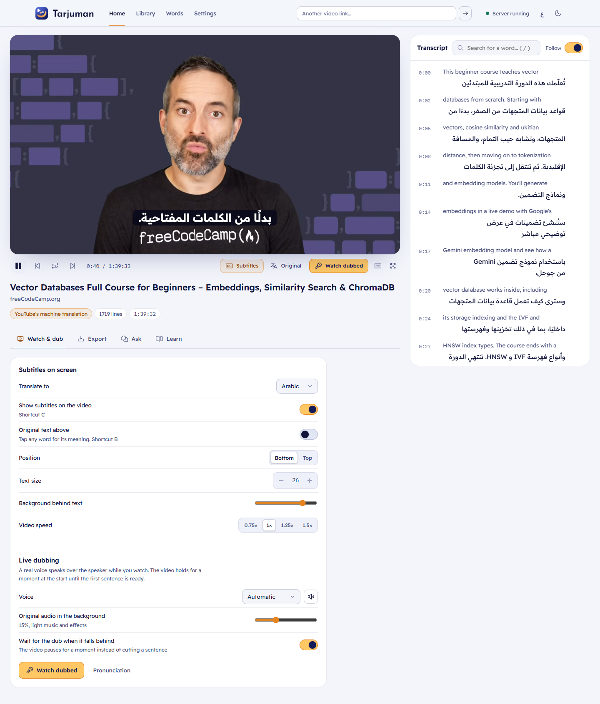

<p align="center">
  
</p>

<h1 align="center">Tarjuman · ترجمان</h1>

<p align="center">
  <strong>Смотрите любое видео на арабском.</strong><br>
  Синхронный перевод, естественный дубляж в реальном времени, дублированные MP4 и расширение для браузера. Всё работает на вашем компьютере.
</p>

<p align="center">
  <a href="../../LICENSE"></a>
  
  
  
</p>

<p align="center">
  <a href="../../README.md">English</a> ·
  <a href="README.ar.md">العربية</a> ·
  <a href="README.fr.md">Français</a> ·
  <a href="README.es.md">Español</a> ·
  <a href="README.de.md">Deutsch</a> ·
  <a href="README.it.md">Italiano</a> ·
  <a href="README.pt.md">Português</a> ·
  <a href="README.tr.md">Türkçe</a> ·
  <b>Русский</b> ·
  <a href="README.ur.md">اردو</a> ·
  <a href="README.fa.md">فارسی</a> ·
  <a href="README.hi.md">हिन्दी</a> ·
  <a href="README.id.md">Bahasa Indonesia</a> ·
  <a href="README.zh.md">中文</a> ·
  <a href="README.ja.md">日本語</a> ·
  <a href="README.ko.md">한국어</a>
</p>

<p align="center">
  
</p>

## Что он умеет

Вставьте ссылку на YouTube, загрузите видео или аудиофайл со своего компьютера, запишите собственный голос или дайте ссылку почти с любого сайта.

- **Синхронные субтитры.** Арабские субтитры появляются на видео строка за строкой, при желании — с оригиналом под ними. Автоматические субтитры перед переводом собираются в цельные предложения. Если в них совсем нет знаков препинания, они разбиваются там, где говорящий действительно делает паузы, по пословным таймингам YouTube.
- **Живой дубляж, похожий на человеческую речь.** Нейросетевой арабский голос произносит каждое предложение в такт с говорящим — на египетском, саудовском, эмиратском, сирийском, иорданском, ливанском, марокканском или иракском диалекте арабского. Ни одно предложение не обрывается и не пропускается. Если человек говорит быстро, видео слегка замедляется, пока голос его не догонит, — голосу не приходится тараторить; замедлите видео сами, и голос получит это дополнительное время. Слова, которые пишутся одинаково, но читаются по-разному, произносятся в соответствии со смыслом предложения (الجُمَل «предложения», а не الجَمَل «верблюд»); это определяется по английскому оригиналу.
- **Дублированный MP4.** Экспортируйте видео с арабской озвучкой. Можно убрать голос исходного диктора, сохранив музыку и эффекты, дать каждому говорящему подходящий мужской или женский голос, а также встроить или вшить субтитры.
- **Нет субтитров? Не беда.** Whisper расшифровывает звук на вашем компьютере, после чего расшифровка переводится. Раздел Настройки → Расшифровка изучает ваш компьютер (память, видеокарту, процессор), рекомендует модель и объясняет почему, а также позволяет выбрать разные модели для записей, для видео и для прослушивания в реальном времени. Для арабской речи есть модель, обученная на диалектах (египетском, заливском, левантийском и других), которая в нашем тесте на египетском голосовом сообщении ошиблась в гораздо меньшем числе слов, чем стандартные модели. Можно добавить список слов, которые она должна распознавать правильно (имена, названия продуктов, английские термины, произнесённые по-арабски), указав, как писать каждое из них, и при желании разрешить вашему ИИ-провайдеру затем исправить расшифровку. Можно добавить любую модель Whisper в формате CTranslate2 — с Hugging Face или из папки на вашем компьютере, — а скачанные модели можно удалить, чтобы освободить место.
- **Аудиофайлы и голосовые сообщения.** Загрузите MP3, M4A, WAV, OGG, Opus, FLAC или голосовое сообщение из WhatsApp либо запишите звук прямо с микрофона. Вместо пустого видео отображается движущаяся звуковая волна с синхронной расшифровкой, а экспортировать можно субтитры, дублированный M4A или видео с волной и вшитыми субтитрами, чтобы поделиться им.
- **Файлы субтитров.** Скачивайте SRT, VTT или простой текст — на арабском или на двух языках, — либо MP4 с субтитрами, готовый к отправке.
- **Целые плейлисты.** Дайте ссылку на плейлист или канал, чтобы получить субтитры, видео с субтитрами или дублированные видео для каждого ролика в нём.
- **Спросите видео** (ИИ по желанию). Получите краткое содержание, ключевые мысли, кликабельные главы и ответы, которые переносят к моменту, где в видео разбирается ваш вопрос. Работает с Claude или любым OpenAI-совместимым провайдером (Gemini, Groq, OpenRouter, Ollama).
- **Страница просмотра под вашим контролем.** Расшифровка рядом с видео подсвечивает каждое слово в момент произнесения, отмечает смену говорящего и звуки вроде [музыка], и по ней можно искать; щёлкните любую строку, чтобы перейти к ней. Главы от автора видео (или из ИИ-сводки) служат заголовками своих частей расшифровки и отмечаются на шкале времени. Шкала под видео показывает, где находятся строки, за плеером мягко светится подсветка в цветах самого видео, а режим кинотеатра (<kbd>T</kbd>) затемняет всё остальное. Любую из этих функций можно отключить или настроить в разделе Настройки → Просмотр. Клавиши: <kbd>→</kbd> следующая строка, <kbd>←</kbd> предыдущая строка, <kbd>R</kbd> повтор, <kbd>K</kbd> воспроизведение или пауза, <kbd>?</kbd> полный список (они работают и с арабской раскладкой клавиатуры).
- **Учите английский.** Нажмите на любое слово, чтобы увидеть его значение, сохраните его вместе с предложением, повторите позже и экспортируйте в Anki. Также можно повторить предложение, ставить паузу после каждой строки или размыть субтитры, чтобы проверить себя.
- **Расширение для браузера.** Используйте те же субтитры и дубляж прямо на YouTube, на видео YouTube, встроенных в другие сайты, на сайтах, где у плеера есть субтитры (Coursera, Udemy и другие), на сайтах с фильмами и аниме, которые встраивают плеер с другого сайта, или на любом другом сайте, слушая звук вкладки. На YouTube оно добавляет расшифровку рядом с видео, значение любого слова, по которому вы щёлкнете, построчные сочетания клавиш и кнопку, чтобы продолжить в приложении.
- **На телефоне.** Откройте приложение с любого телефона в той же сети Wi-Fi.

Переводить и дублировать можно на **74 языка**, каждый с родными голосами (японский звучит по-японски, хинди — как хинди), и всё это может работать без интернета:

- **Офлайн-перевод:** один раз скачайте модель языка (Настройки → Офлайн-перевод), и перевод будет выполняться на вашем компьютере — когда Google недоступен или всегда.
- **Офлайн-голоса** на 31 языке, которые дублируют в реальном времени на обычном ноутбуке.
- **Голосовые пакеты**, которые устанавливаются, только если они вам нужны: дублируйте MP4 **собственным голосом исходного диктора** (экспериментально) или **голосами арабских диалектов** (египетского, иракского, марокканского…) на компьютере с мощной видеокартой.

## Скриншоты

<table>
  <tr>
    <td width="50%"></td>
    <td width="50%"></td>
  </tr>
  <tr>
    <td></td>
    <td></td>
  </tr>
  <tr>
    <td></td>
    <td></td>
  </tr>
</table>

<p align="center">
  
  
</p>

## Быстрый старт

### Установщик для Windows

Скачайте `Tarjuman-Setup-<version>.exe` со страницы [Releases](https://github.com/MohamedElnagar94/tarjuman/releases) и запустите его. В нём уже есть собственный Python, все пакеты, веб-приложение и расширение для браузера, так что ни Python, ни Node.js вам не нужны. Он один раз запрашивает права администратора, устанавливается в Program Files и не трогает брандмауэр. После этого Tarjuman открывается в собственном окне, как любое настольное приложение, без окна консоли и без вкладки браузера. По умолчанию закрытие окна останавливает его; в разделе Настройки → Рабочий стол можно вместо этого оставлять его в области уведомлений, держать движок запущенным для расширения браузера и запускать его вместе с Windows. (Это окно представляет собой Microsoft Edge в режиме приложения, который есть в каждой Windows 10 и 11; ничего дополнительно не устанавливается.)

- Если Setup сразу останавливается с сообщением "unable to create the directory ...\Temp\is-*.tmp, access is denied", значит, файл установщика лежит в папке с низким уровнем целостности (некоторые инструменты-песочницы помечают так свои рабочие папки; тогда `icacls <file>` показывает `Low Mandatory Level`). Windows запускает такой файл с урезанными правами. Скопируйте его в другую папку, например в Downloads, и запустите копию.
- Установщик пока не подписан сертификатом, поэтому Windows SmartScreen может сообщить о «неизвестном издателе»: выберите *Подробнее → Выполнить в любом случае*.
- При первом запуске в фоне скачивается офлайн-голос для арабского (около 60 МБ). Модель Whisper скачивается сама, когда она впервые понадобится для видео.
- Обновления: раздел Настройки → Обновления показывает, что добавляет и исправляет новая версия, и устанавливает её одним щелчком (или сам, если вы это включите).
- Ваши видео, субтитры, настройки и `.env` хранятся в `%LOCALAPPDATA%\Tarjuman`, отдельно от программы. При обновлении они сохраняются; при удалении программа спрашивает, удалять ли их.
- В меню «Пуск» есть ярлык папки расширения, чтобы указать её через *Загрузить распакованное расширение* в `chrome://extensions`.

Что-то не работает? Смотрите [Устранение неполадок](../troubleshooting.md). Что изменилось в каждой версии, описано в [журнале изменений](../../CHANGELOG.md).

### Linux (AppImage)

Скачайте `Tarjuman-<version>-x86_64.AppImage` со страницы [Releases](https://github.com/MohamedElnagar94/tarjuman/releases), сделайте файл исполняемым и запустите его. Как и установщик для Windows, он содержит собственный Python, все пакеты, веб-приложение и расширение.

```sh
chmod +x Tarjuman-*-x86_64.AppImage
./Tarjuman-*-x86_64.AppImage
```

- Он открывается в собственном окне, если установлен Chrome, Chromium или Edge, а иначе — в браузере по умолчанию (тогда он работает, пока вы не выйдете из системы, или до `pkill -f "tarjuman app"`).
- Ваши данные хранятся в `~/.local/share/Tarjuman`. Раздел Настройки → Обновления после проверки заменяет AppImage более новым; перезапустите Tarjuman, чтобы перейти на него.
- Если появляется сообщение, что отсутствует FUSE (в некоторых дистрибутивах и в WSL), запустите его с `--appimage-extract-and-run` или установите `libfuse2`.
- Значок в области уведомлений и настройки раздела «Рабочий стол» пока есть только в Windows.

### Из исходного кода

Нужны **Python 3.11+** и **Node.js 20+**.

**Windows:** дважды щёлкните `start.cmd`. Если Windows спрашивает, запускать ли скрипт неизвестного издателя, один раз создайте ярлык на рабочем столе командой `powershell -ExecutionPolicy Bypass -File scripts/create-shortcut.ps1` и запускайте Tarjuman с него: ярлык выполняет тот же скрипт через встроенный в Windows `cmd.exe`, поэтому запрос не появляется.

**macOS / Linux:**

```sh
./start.sh
```

В Debian, Ubuntu и Kali сначала установите `python3-venv`, если его нет (`sudo apt install python3-venv`).

Первый запуск устанавливает всё: пакеты Python, офлайн-голос для арабского и сборку веб-приложения. Затем приложение открывается по адресу `http://127.0.0.1:4318`. В дальнейшем оно запускается за пару секунд. Чтобы пользоваться им с телефона, откройте адрес, который оно выводит для вашей сети Wi-Fi. Если в Windows телефон не может подключиться, один раз запустите `scripts/allow-phone.ps1` от имени администратора: скрипт пометит домашнюю сеть Wi-Fi как частную и откроет порты Tarjuman только в частных сетях.

<details>
<summary>Ручная установка</summary>

```sh
python -m venv .venv
.venv/bin/pip install -r backend/requirements.txt        # Windows: .venv\Scripts\pip
npm --prefix frontend install && npm --prefix frontend run build
PYTHONPATH=backend .venv/bin/python -m tarjuman           # Windows: set PYTHONPATH=backend
```

</details>

### Команды

| Команда | Что делает |
|---|---|
| `python -m tarjuman` | Запускает приложение (`--port`, `--host 127.0.0.1` — только для этого компьютера, `--no-open`) |
| `python -m tarjuman app` | Запускает приложение в собственном окне (Edge или Chrome в режиме приложения), а не во вкладке браузера; в Windows — со значком в области уведомлений (`--background` запускает его там без окна) |
| `python -m tarjuman subs <link>` | Записывает файлы субтитров в `data/output` (`--lang`, `--format srt,vtt,txt`) |
| `python -m tarjuman setup` | Устанавливает или чинит всё |
| `python -m tarjuman update` | Обновляет yt-dlp и голосовой клиент, если перестали работать загрузки или голоса |
| `python -m tarjuman doctor` | Проверяет все компоненты |

## Расширение для браузера

<p align="center">
  
</p>

Установите его прямо из [Chrome Web Store](https://chromewebstore.google.com/detail/gcfnomfbpenbhdebopmpdfamlaiodflp) или соберите из исходного кода, выполнив следующие шаги:

1. Соберите его один раз: `npm --prefix extension install && npm --prefix extension run build`.
2. Откройте `chrome://extensions` (или `edge://extensions`), включите **Режим разработчика**, нажмите **Загрузить распакованное расширение** и выберите `extension/dist`.
3. Не закрывайте приложение, откройте видео и нажмите на значок Tarjuman или нажмите <kbd>Alt</kbd>+<kbd>Shift</kbd>+<kbd>A</kbd>.
4. На странице параметров расширения задаются шрифт субтитров, язык расширения (как в браузере, арабский или английский), сочетания клавиш и то, запускается ли оно само на YouTube (никогда, всегда или только на выбранных вами каналах).

Во время перевода:

- **Расшифровка рядом с видео** на YouTube: все строки, текущая подсвечена; щёлкните строку, чтобы перейти к ней, или воспользуйтесь поиском.
- **Щёлкните слово** в исходной строке, чтобы увидеть его значение, и сохраните его вместе с предложением в *Мои слова* в приложении.
- **Сочетания клавиш:** <kbd>Alt</kbd>+<kbd>→</kbd> следующая строка, <kbd>Alt</kbd>+<kbd>←</kbd> предыдущая строка, <kbd>Alt</kbd>+<kbd>↓</kbd> повтор, <kbd>Alt</kbd>+<kbd>S</kbd> субтитры, <kbd>Alt</kbd>+<kbd>V</kbd> дубляж, <kbd>Alt</kbd>+<kbd>T</kbd> расшифровка.
- **Синхронизация:** если строки появляются раньше или позже речи, сдвиньте их с помощью <kbd>Alt</kbd>+<kbd>[</kbd> и <kbd>Alt</kbd>+<kbd>]</kbd> (дубляж сдвигается вместе с ними).
- **Открыть в приложении** на том же моменте — для экспорта и полной страницы просмотра.
- Расширение продолжает работать в мини-плеере YouTube, переходит вслед за сайтом с курсами к следующему уроку и по-прежнему показывает строку, когда сайт разворачивает само видео на весь экран.

Если Chrome показывает *Proceed with caution: this extension is not trusted by Enhanced Safe Browsing*, это потому, что издатель недавно появился в Chrome Web Store: Chrome показывает это предупреждение для каждого нового издателя, пока тот несколько месяцев соблюдает правила магазина, и только тем, кто включил улучшенную защиту. Расширение прошло проверку магазина, а его [исходный код](https://github.com/MohamedElnagar94/tarjuman/tree/main/extension) открыт. Выберите *Continue to install*.

Расширение общается только с приложением на вашем компьютере. Его комплект для Chrome Web Store (текст страницы, обоснование разрешений, политика конфиденциальности, рекламные изображения) лежит в [`extension/store`](../../extension/store).

## Как дубляж остаётся синхронным

Строки субтитров объединяются в цельные предложения, а слова-паразиты удаляются. Затем скорость каждого предложения выбирается по окну упреждения примерно в 12 секунд: свободное предложение «одалживает» время плотному, а скорость меняется плавно, без скачков. Прежде чем браузер воспроизведёт первые предложения очередного фрагмента, сервер синтезирует и измеряет их, поэтому план строится на реальных длительностях, а не на догадках, а следующий фрагмент сервер готовит в фоне. Если дубляж всё же отстаёт, видео замедляется до 85% от вашей скорости, пока голос не догонит его, и ставится на паузу, только когда разрыв превышает примерно две секунды. Темп подстраивается под скорость воспроизведения. При перемотке в любое место дубляж продолжается точно с этой точки. Когда бесплатные переводчики ограничивают число запросов, дубляж не умолкает благодаря второму адресу Google, а затем собственному переводу YouTube.

Полное описание устройства — в [docs/implementation.md](../implementation.md).

## Конфиденциальность

Tarjuman работает прежде всего локально. Ваши видео, субтитры, сохранённые слова, настройки и API-ключ остаются в папке `data/` на вашем компьютере. Приложение обращается к YouTube (субтитры и загрузки), Google Translate и MyMemory (перевод), голосовому сервису Edge от Microsoft (синтез речи) и, только если вы это включите, к выбранному вами ИИ-провайдеру. Никаких аккаунтов, аналитики и слежки. Видео и звук никогда никуда не отправляются.

| Функция | Что покидает ваш компьютер | Куда отправляется | Без отправки чего-либо |
|---|---|---|---|
| Субтитры YouTube | Ссылка на видео | YouTube | Загрузите файл; он расшифровывается локально |
| Перевод | Предложения из видео в виде текста | Google Translate, затем MyMemory | Офлайн-модели перевода (Настройки → Офлайн-перевод) |
| Голос дубляжа | Каждое переведённое предложение и название голоса | Голоса Microsoft Edge, затем Google | Офлайн-голоса (Supertonic, 31 язык; Piper для арабского) и голосовые пакеты |
| Загрузка видео | Запрос на видео | Сайт, на котором оно размещено | Файл, который уже есть на вашем компьютере |
| ИИ (по желанию, по умолчанию выключен) | Текст видео и ваш вопрос | Выбранный вами провайдер | Не включайте его или используйте локальный сервер, например Ollama |
| Загрузка моделей | Запрос на скачивание, один раз | Hugging Face, GitHub, Хельсинкский университет (модели перевода), PyTorch и PyPI (голосовые пакеты) | Ничего после первого скачивания |
| Проверка обновлений | Запрос списка новых версий, раз в несколько часов | GitHub | Отключите «Проверять обновления автоматически» в разделе Настройки → Обновления |
| Исправление расшифровки (по желанию, по умолчанию выключено) | Текст расшифровки | Выбранный вами ИИ-провайдер | Не включайте его; список слов работает и без него |
| Распознавание речи, отделение музыки, ваши файлы и записи | Ничего | – | Всегда локально |

Та же таблица есть в приложении: Настройки → Конфиденциальность. API отклоняет запросы с других сайтов, а настройки ИИ можно изменить только с компьютера, на котором запущено приложение.

## Настройка

Скопируйте `.env.example` в `.env` в папке проекта и отредактируйте его; каждая настройка объяснена там на арабском и английском. Файл читается при запуске, поэтому после изменения перезапустите Tarjuman. Переменная, заданная в настоящем окружении, имеет приоритет над файлом.

| Переменная окружения | По умолчанию | Значение |
|---|---|---|
| `TARJUMAN_HOME` | папка проекта | Где хранится `data/` |
| `TARJUMAN_PORT` | `4318` | Первый порт для попытки (если занят, берётся следующий; расширение подстраивается) |
| `TARJUMAN_HOST` | `0.0.0.0` | Укажите `127.0.0.1`, чтобы приложение не было доступно из Wi-Fi |
| `TARJUMAN_WHISPER_MODEL` | (пусто) | Выбирается в разделе Настройки → Расшифровка, который рекомендует модель для вашего компьютера; значение здесь используется, пока эта настройка стоит на «Автоматически» |
| `TARJUMAN_VOICE_CACHE_GB` | `2` | Предел размера сохранённых голосов озвучки; первыми удаляются давно не использованные |
| `TARJUMAN_MAX_UPLOAD_GB` | `8` | Максимальный размер загружаемого видео |
| `TARJUMAN_PAIR_MINUTES` | `15` | Сколько минут действует код сопряжения с телефоном (QR); `0` = пока вы не создадите новый |
| `TARJUMAN_FETCH_PRIVATE` | выключено | Укажите `1`, чтобы разрешить загрузку с адресов внутри вашей собственной сети |
| `TARJUMAN_HEAVY_JOBS` | `2` | Сколько тяжёлых задач (Whisper, дубляж, вшивание субтитров) выполняется одновременно; на компьютере с небольшим объёмом памяти укажите `1` |
| `TARJUMAN_MAX_QUEUE` | `20` | Максимум задач, которые могут ждать своей очереди |
| `TARJUMAN_FORCE_ASR` | выключено | Укажите `1`, чтобы всегда расшифровывать через Whisper, игнорируя субтитры YouTube |
| `ANTHROPIC_API_KEY` | – | Используется для Claude, если в настройках не сохранён ключ |

## Структура проекта

```
backend/     Python package `tarjuman` (FastAPI): captions, translation, voices, dubbing, AI, jobs
frontend/    Vue 3 + Vite + TypeScript web app
extension/   Chrome / Edge extension (Manifest V3, Vue + Vite) and its store kit
shared/      the live dub engine used by both the web app and the extension
assets/      brand (icon source and renders)
docs/        plan, specification, implementation notes, translated READMEs, screenshots
```

## Разработка

```sh
# backend tests (offline)
cd backend && ../.venv/bin/python -m pytest      # Windows: ..\.venv\Scripts\python

# dub engine tests
npm test

# web app with hot reload (proxies the API to 127.0.0.1:4318)
npm --prefix frontend run dev

# extension: build, test, package a store zip
npm --prefix extension run build && npm --prefix extension test && npm --prefix extension run package
```

Прочитайте [docs/specs.md](../specs.md), прежде чем менять маршрут API: от него зависят и веб-приложение, и расширение.

### Сборка установщика для Windows

```powershell
powershell -ExecutionPolicy Bypass -File installer\build.ps1   # build\windows\app: Python, packages, web app, extension
iscc /DAppVersion=3.0.0 installer\tarjuman.iss                # build\windows\Tarjuman-Setup-3.0.0.exe (Inno Setup 6)
```

Workflow *Windows installer* делает то же самое на GitHub: запустите его на вкладке Actions или отправьте тег вида `v3.0.0`, чтобы прикрепить установщик к релизу. Перед компиляцией он запускает собранное приложение и проверяет, что оно отвечает.

### Сборка Linux AppImage

```sh
installer/linux/build.sh   # build/linux/Tarjuman-<version>-x86_64.AppImage (needs curl, python3, Node.js 20+)
```

AppImage включает переносимый Python из python-build-standalone. Тот же workflow собирает его рядом с установщиком для Windows и публикует оба по тегу `v*`.

## Создано с помощью

[faster-whisper](https://github.com/SYSTRAN/faster-whisper) ·
[edge-tts](https://github.com/rany2/edge-tts) ·
[Piper](https://github.com/rhasspy/piper) ·
[yt-dlp](https://github.com/yt-dlp/yt-dlp) ·
[модели MDX-Net из Ultimate Vocal Remover](https://github.com/TRvlvr/model_repo) ·
[FastAPI](https://fastapi.tiangolo.com) ·
[Vue](https://vuejs.org) ·
[Claude](https://www.anthropic.com/claude)

## Лицензия

[MIT](../../LICENSE). Загрузка видео и субтитров регулируется условиями каждого сайта. Используйте Tarjuman для контента, который вам разрешено смотреть и адаптировать.
