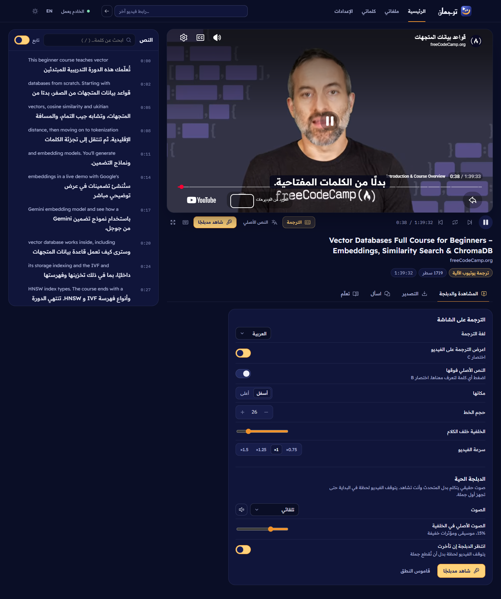
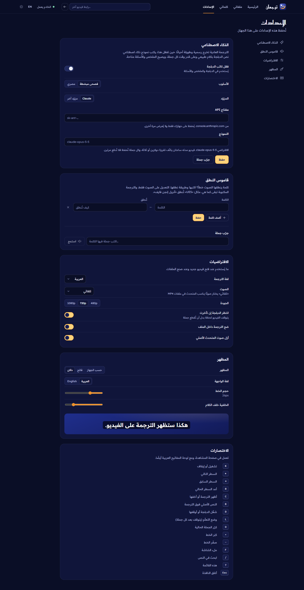

<p align="center">
  
</p>

<h1 align="center">Tarjuman · ترجمان</h1>

<p align="center">
  <strong>Her videoyu Arapça izleyin.</strong><br>
  Senkronize çeviri, doğal canlı seslendirme, seslendirilmiş MP4'ler ve bir tarayıcı eklentisi. Her şey kendi bilgisayarınızda çalışır.
</p>

<p align="center">
  <a href="../../LICENSE"></a>
  
  
  
</p>

<p align="center">
  <a href="../../README.md">English</a> ·
  <a href="README.ar.md">العربية</a> ·
  <a href="README.fr.md">Français</a> ·
  <a href="README.es.md">Español</a> ·
  <a href="README.de.md">Deutsch</a> ·
  <a href="README.it.md">Italiano</a> ·
  <a href="README.pt.md">Português</a> ·
  <b>Türkçe</b> ·
  <a href="README.ru.md">Русский</a> ·
  <a href="README.ur.md">اردو</a> ·
  <a href="README.fa.md">فارسی</a> ·
  <a href="README.hi.md">हिन्दी</a> ·
  <a href="README.id.md">Bahasa Indonesia</a> ·
  <a href="README.zh.md">中文</a> ·
  <a href="README.ja.md">日本語</a> ·
  <a href="README.ko.md">한국어</a>
</p>

<p align="center">
  
</p>

## Ne yapar

Bir YouTube bağlantısı yapıştırın, bilgisayarınızdan bir video veya ses dosyası yükleyin, kendi sesinizi kaydedin ya da neredeyse herhangi bir siteden bağlantı verin.

- **Senkronize altyazılar.** Arapça altyazılar videonun üzerinde satır satır görünür; isterseniz altında orijinal dil de yer alır. Otomatik oluşturulan altyazılar çevrilmeden önce tam cümlelere dönüştürülür. Hiç noktalama işareti yoksa, YouTube'un kelime bazındaki zamanlamaları kullanılarak konuşmacının gerçekten duraksadığı yerlerden bölünür.
- **İnsan gibi konuşan canlı seslendirme.** Nöral bir Arapça ses, her cümleyi konuşmacıyla aynı zamanlamada; Mısır, Suudi, Emirlik, Suriye, Ürdün, Lübnan, Fas veya Irak Arapçasıyla okur. Hiçbir cümle kesilmez ya da atlanmaz. Konuşmacı hızlıysa ses yetişmek için acele etmez; bunun yerine ses yetişene kadar video biraz yavaşlar. Videoyu kendiniz yavaşlatırsanız bu ek süre sese kalır. Yazılışı aynı ama okunuşu farklı kelimeler, İngilizce asıl metne bakılarak cümlenin anlamına göre okunur (الجَمَل "deve" değil, الجُمَل "cümleler").
- **Seslendirilmiş MP4.** Videoyu Arapça seslendirmeyle dışa aktarın. Müzik ve efektleri korurken orijinal konuşmacının sesini kaldırabilir, her konuşmacıya uygun bir erkek ya da kadın sesi atayabilir, altyazıları gömebilir veya görüntüye yakabilir.
- **Altyazı yok mu? Sorun değil.** Whisper sesi bilgisayarınızda yazıya döker, ardından bu döküm çevrilir. Ayarlar → Yazıya dökme bölümü bilgisayarınızı (bellek, ekran kartı, işlemci) inceler, bir model önerir ve nedenini söyler; kayıtlar, videolar ve canlı dinleme için ayrı ayrı model seçmenize de izin verir. Arapça konuşma için lehçelerle (Mısır, Körfez, Levant ve diğerleri) eğitilmiş bir model vardır; Mısır lehçesindeki bir sesli mesajla yaptığımız testte standart modellerden çok daha az kelimeyi yanlış yazdı. Doğru yazması gereken kelimelerden (isimler, ürünler, Arapça konuşurken söylenen İngilizce terimler) bir liste ekleyip her birinin nasıl yazılacağını belirtebilir, isterseniz dökümü sonradan yapay zekâ sağlayıcınızın düzeltmesine izin verebilirsiniz. CTranslate2 biçimindeki herhangi bir Whisper modeli Hugging Face'ten ya da bilgisayarınızdaki bir klasörden eklenebilir; indirilen modeller yer açmak için silinebilir.
- **Ses dosyaları ve sesli mesajlar.** MP3, M4A, WAV, OGG, Opus, FLAC dosyası ya da bir WhatsApp sesli mesajı yükleyin veya doğrudan mikrofonunuzdan kaydedin. Boş bir video yerine hareket eden bir ses dalgası ve onunla senkronize döküm görünür; dışa aktarım olarak altyazı, seslendirilmiş bir M4A ya da paylaşmak için ses dalgası ve görüntüye yakılmış altyazılar içeren bir video alabilirsiniz.
- **Altyazı dosyaları.** SRT, VTT veya düz metin olarak, Arapça ya da iki dilli indirin; dilerseniz paylaşmaya hazır altyazılı bir MP4 alın.
- **Oynatma listelerinin tamamı.** Bir oynatma listesi veya kanal bağlantısı verin; içindeki her video için altyazı, altyazılı video ya da seslendirilmiş video üretsin.
- **Videoya sorun** (isteğe bağlı yapay zekâ). Bir özet, ana noktalar, tıklanabilir bölümler ve sizi videonun sorunuzu ele aldığı ana götüren yanıtlar alın. Claude veya OpenAI uyumlu herhangi bir sağlayıcıyla (Gemini, Groq, OpenRouter, Ollama) çalışır.
- **Kontrolü sizde olan bir izleme sayfası.** Videonun yanındaki döküm, her kelimeyi söylendiği anda vurgular, konuşmacı değişimlerini ve [müzik] gibi sesleri işaretler ve içinde arama yapılabilir; herhangi bir satıra tıklayarak oraya atlayın. Video sahibinin bölümleri (ya da yapay zekâ özetinden gelenler) dökümde kendi kısımlarının başlığı olur ve zaman çizelgesinde işaretlenir. Videonun altındaki zaman çizelgesi satırların nerede olduğunu gösterir, oynatıcının arkasında videonun kendi renklerinde yumuşak bir ışık parlar ve sinema modu (<kbd>T</kbd>) geri kalan her şeyi karartır. Bunların her biri Ayarlar → İzleme bölümünden kapatılabilir veya ayarlanabilir. Klavye: <kbd>→</kbd> sonraki satır, <kbd>←</kbd> önceki satır, <kbd>R</kbd> tekrar, <kbd>K</kbd> oynat veya duraklat, <kbd>?</kbd> tam liste (Arapça klavye düzeniyle de çalışırlar).
- **İngilizce öğrenin.** Anlamını görmek için herhangi bir kelimeye dokunun, onu cümlesiyle birlikte kaydedin, daha sonra tekrar edin ve Anki'ye aktarın. Ayrıca bir cümleyi tekrarlayabilir, her satırdan sonra duraklatabilir ya da kendinizi sınamak için altyazıları bulanıklaştırabilirsiniz.
- **Tarayıcı eklentisi.** Aynı altyazıları ve seslendirmeyi doğrudan YouTube'da, başka sitelere yerleştirilmiş YouTube videolarında, oynatıcısında altyazı bulunan sitelerde (Coursera, Udemy ve diğerleri), oynatıcısını başka bir siteden yerleştiren film ve anime sitelerinde ya da sekmenin sesini dinleyerek başka herhangi bir sitede kullanın. YouTube'da videonun yanına bir döküm, tıkladığınız her kelimenin anlamını, satır satır kısayolları ve uygulamada devam etmek için bir düğme ekler.
- **Telefonunuzda.** Uygulamayı aynı Wi-Fi ağındaki herhangi bir telefondan açın.

**74 dile** çeviri ve seslendirme yapılabilir; her birinin kendi yerli sesleri vardır (Japonca Japon gibi, Hintçe Hintli gibi konuşur) ve hepsi internet olmadan çalışabilir:

- **Çevrimdışı çeviri:** bir dilin modelini bir kez indirin (Ayarlar → Çevrimdışı çeviri); çeviri, Google'a erişilemediğinde ya da her zaman bilgisayarınızda çalışır.
- 31 dilde, sıradan bir dizüstü bilgisayarda canlı seslendirme yapan **çevrimdışı sesler**.
- Yalnızca isterseniz kurulan **ses paketleri**: bir MP4'ü **orijinal konuşmacının kendi sesiyle** (deneysel) ya da güçlü bir ekran kartı olan bilgisayarda **Arapça lehçe sesleriyle** (Mısır, Irak, Fas…) seslendirin.

## Ekran görüntüleri

<table>
  <tr>
    <td width="50%"></td>
    <td width="50%"></td>
  </tr>
  <tr>
    <td></td>
    <td></td>
  </tr>
  <tr>
    <td></td>
    <td></td>
  </tr>
</table>

<p align="center">
  
  
</p>

## Hızlı başlangıç

### Windows yükleyicisi

[Releases](https://github.com/MohamedElnagar94/tarjuman/releases) sayfasından `Tarjuman-Setup-<version>.exe` dosyasını indirip çalıştırın. Kendi Python'ını, bütün paketleri, web uygulamasını ve tarayıcı eklentisini beraberinde getirir; bu yüzden ne Python'a ne de Node.js'e ihtiyacınız olur. Bir kez yönetici yetkisi ister, Program Files klasörüne kurulur ve güvenlik duvarına dokunmaz. Ardından Tarjuman, herhangi bir masaüstü uygulaması gibi kendi penceresinde açılır; konsol penceresi de tarayıcı sekmesi de yoktur. Varsayılan olarak pencereyi kapatmak uygulamayı durdurur; Ayarlar → Masaüstü bunun yerine uygulamayı bildirim alanında tutabilir, motoru tarayıcı eklentisi için çalışır durumda bırakabilir ve Windows ile birlikte başlatabilir. (Bu pencere, her Windows 10 ve 11'de bulunan Microsoft Edge'in uygulama modudur; ek bir şey kurulmaz.)

- Setup hemen "unable to create the directory ...\Temp\is-*.tmp, access is denied" hatasıyla durursa, yükleyici dosyası düşük bütünlük düzeyiyle işaretlenmiş bir klasörde duruyordur (bazı korumalı alan araçları çalışma klasörlerini böyle işaretler; bu durumda `icacls <file>` çıktısında `Low Mandatory Level` görünür). Windows böyle bir dosyayı daha az yetkiyle çalıştırır. Dosyayı Downloads gibi başka bir klasöre kopyalayın ve kopyayı çalıştırın.
- Yükleyici henüz kod imzalı değildir; bu yüzden Windows SmartScreen "bilinmeyen yayıncı" diyebilir: *Ek bilgi → Yine de çalıştır* seçeneğini seçin.
- İlk başlatmada çevrimdışı Arapça ses (yaklaşık 60 MB) arka planda indirilir. Whisper modeli, bir video ona ilk kez ihtiyaç duyduğunda kendiliğinden indirilir.
- Güncellemeler: Ayarlar → Güncellemeler yeni bir sürümün neler eklediğini ve düzelttiğini gösterir ve onu tek tıklamayla kurar (ya da bu seçeneği açarsanız kendiliğinden).
- Videolarınız, altyazılarınız, ayarlarınız ve `.env` dosyası programdan ayrı olarak `%LOCALAPPDATA%\Tarjuman` klasöründe tutulur. Güncelleme bunları korur; kaldırma sırasında silinip silinmeyecekleri sorulur.
- Başlat menüsünde, `chrome://extensions` sayfasındaki *Paketlenmemiş öğe yükle* için eklenti klasörüne giden bir kısayol bulunur.

Bir şey çalışmıyor mu? [Sorun giderme](../troubleshooting.md) belgesine bakın. Her sürümde nelerin değiştiği [değişiklik günlüğünde](../../CHANGELOG.md) yer alır.

### Linux (AppImage)

[Releases](https://github.com/MohamedElnagar94/tarjuman/releases) sayfasından `Tarjuman-<version>-x86_64.AppImage` dosyasını indirin, çalıştırılabilir yapın ve çalıştırın. Windows yükleyicisi gibi kendi Python'ını, bütün paketleri, web uygulamasını ve eklentiyi beraberinde getirir.

```sh
chmod +x Tarjuman-*-x86_64.AppImage
./Tarjuman-*-x86_64.AppImage
```

- Chrome, Chromium veya Edge kuruluysa kendi penceresinde, değilse varsayılan tarayıcınızda açılır (bu durumda oturumu kapatana kadar ya da `pkill -f "tarjuman app"` komutuna kadar çalışmaya devam eder).
- Verileriniz `~/.local/share/Tarjuman` klasöründe tutulur. Ayarlar → Güncellemeler, AppImage dosyasını doğruladıktan sonra daha yeni bir sürümle değiştirir; yeni sürümü kullanmak için Tarjuman'ı yeniden başlatın.
- FUSE'un eksik olduğunu söylerse (bazı dağıtımlarda ve WSL'de), `--appimage-extract-and-run` ile çalıştırın ya da `libfuse2` paketini kurun.
- Bildirim alanı simgesi ve Masaüstü ayarları şimdilik yalnızca Windows'ta vardır.

### Kaynak koddan

**Python 3.11+** ve **Node.js 20+** gerekir.

**Windows:** `start.cmd` dosyasına çift tıklayın. Windows bilinmeyen bir yayıncının betiğini çalıştırmak isteyip istemediğinizi sorarsa, `powershell -ExecutionPolicy Bypass -File scripts/create-shortcut.ps1` ile bir kez masaüstü kısayolu oluşturun ve Tarjuman'ı oradan başlatın; kısayol aynı betiği Windows'un kendi `cmd.exe`'si üzerinden çalıştırdığı için bu soru çıkmaz.

**macOS / Linux:**

```sh
./start.sh
```

Debian, Ubuntu ve Kali'de `python3-venv` eksikse önce onu kurun (`sudo apt install python3-venv`).

İlk çalıştırma her şeyi kurar: Python paketlerini, çevrimdışı Arapça sesi ve web uygulamasının derlenmiş hâlini. Ardından uygulama `http://127.0.0.1:4318` adresinde açılır. Sonraki çalıştırmalarda birkaç saniyede başlar. Telefonunuzdan kullanmak için Wi-Fi ağınız için yazdırdığı adresi açın. Windows'ta telefon uygulamaya erişemiyorsa `scripts/allow-phone.ps1` betiğini bir kez yönetici olarak çalıştırın: ev Wi-Fi ağınızı Özel olarak işaretler ve Tarjuman'ın portlarını yalnızca özel ağlarda açar.

<details>
<summary>Elle kurulum</summary>

```sh
python -m venv .venv
.venv/bin/pip install -r backend/requirements.txt        # Windows: .venv\Scripts\pip
npm --prefix frontend install && npm --prefix frontend run build
PYTHONPATH=backend .venv/bin/python -m tarjuman           # Windows: set PYTHONPATH=backend
```

</details>

### Komutlar

| Komut | Ne yapar |
|---|---|
| `python -m tarjuman` | Uygulamayı başlatır (`--port`, yalnızca bu bilgisayar için `--host 127.0.0.1`, `--no-open`) |
| `python -m tarjuman app` | Uygulamayı tarayıcı sekmesi yerine kendi penceresinde başlatır (uygulama modunda Edge veya Chrome); Windows'ta bildirim alanı simgesiyle birlikte (`--background` onu pencere açmadan orada başlatır) |
| `python -m tarjuman subs <link>` | Altyazı dosyalarını `data/output` klasörüne yazar (`--lang`, `--format srt,vtt,txt`) |
| `python -m tarjuman setup` | Her şeyi kurar veya onarır |
| `python -m tarjuman update` | İndirmeler ya da sesler çalışmaz olursa yt-dlp'yi ve ses istemcisini günceller |
| `python -m tarjuman doctor` | Her bileşeni denetler |

## Tarayıcı eklentisi

<p align="center">
  
</p>

Doğrudan [Chrome Web Mağazası](https://chromewebstore.google.com/detail/gcfnomfbpenbhdebopmpdfamlaiodflp) üzerinden kurun ya da aşağıdaki adımlarla kaynaktan derleyin:

1. Bir kez derleyin: `npm --prefix extension install && npm --prefix extension run build`.
2. `chrome://extensions` (veya `edge://extensions`) sayfasını açın, **Geliştirici modu**'nu etkinleştirin, **Paketlenmemiş öğe yükle**'ye tıklayın ve `extension/dist` klasörünü seçin.
3. Uygulamayı açık tutun, bir video açın ve Tarjuman simgesine tıklayın ya da <kbd>Alt</kbd>+<kbd>Shift</kbd>+<kbd>A</kbd> tuşlarına basın.
4. Seçenekler sayfasından altyazı yazı tipini, eklentinin dilini (tarayıcının dili, Arapça veya İngilizce), klavye kısayollarını ve YouTube'da kendiliğinden başlayıp başlamayacağını (hiçbir zaman, her zaman ya da yalnızca seçtiğiniz kanallarda) ayarlayabilirsiniz.

Çeviri sürerken:

- YouTube'da **videonun yanında döküm**: bütün satırlar, o anki satır vurgulanmış hâlde; bir satıra tıklayarak ona atlayın ya da arama yapın.
- Anlamını görmek için orijinal satırdaki **bir kelimeye tıklayın** ve onu cümlesiyle birlikte uygulamadaki *Kelimelerim* listesine kaydedin.
- **Kısayollar:** <kbd>Alt</kbd>+<kbd>→</kbd> sonraki satır, <kbd>Alt</kbd>+<kbd>←</kbd> önceki satır, <kbd>Alt</kbd>+<kbd>↓</kbd> tekrar, <kbd>Alt</kbd>+<kbd>S</kbd> altyazılar, <kbd>Alt</kbd>+<kbd>V</kbd> seslendirme, <kbd>Alt</kbd>+<kbd>T</kbd> döküm.
- **Zamanlama:** satırlar konuşmadan önce ya da sonra geliyorsa onları <kbd>Alt</kbd>+<kbd>[</kbd> ve <kbd>Alt</kbd>+<kbd>]</kbd> ile kaydırın (seslendirme de onlarla birlikte kayar).
- Dışa aktarımlar ve tam izleme sayfası için aynı anda **uygulamada açın**.
- YouTube'un mini oynatıcısında çalışmayı sürdürür, bir kurs sitesini bir sonraki derse kadar izler ve bir site videoyu tek başına tam ekran yaptığında da satırı göstermeye devam eder.

Chrome *Proceed with caution: this extension is not trusted by Enhanced Safe Browsing* uyarısı gösterirse, bunun nedeni yayıncının Chrome Web Mağazası'nda yeni olmasıdır: Chrome bu uyarıyı her yeni yayıncı için, mağaza politikalarına birkaç ay uyana kadar ve yalnızca gelişmiş korumayı açanlara gösterir. Uzantı mağazanın incelemesinden geçti ve [kaynak kodu](https://github.com/MohamedElnagar94/tarjuman/tree/main/extension) açıktır. *Continue to install* seçeneğini seçin.

Eklenti yalnızca bilgisayarınızdaki uygulamayla iletişim kurar. Chrome Web Store kiti (mağaza metni, izin gerekçeleri, gizlilik politikası, tanıtım görselleri) [`extension/store`](../../extension/store) klasöründedir.

## Seslendirme nasıl senkron kalır

Altyazı satırları tam cümlelerde birleştirilir ve dolgu sözcükleri çıkarılır. Ardından her cümlenin hızı yaklaşık 12 saniyelik bir ileriye bakış penceresine göre seçilir; böylece rahat bir cümle sıkışık bir cümleye zaman ödünç verir ve hız sıçramak yerine kademeli olarak değişir. Tarayıcı her bölümün ilk cümlelerini çalmadan önce sunucu bu cümleleri sentezler ve sürelerini ölçer; yani plan tahminlere değil gerçek sürelere dayanır, sunucu da bir sonraki bölümü arka planda hazırlar. Seslendirme yine de geride kalırsa video, ses yetişene kadar sizin hızınızın %85'ine yavaşlar ve yalnızca fark yaklaşık iki saniyeyi aştığında duraklar. Tempo oynatma hızınızı izler. Herhangi bir noktaya atladığınızda seslendirme tam o yerden devam eder. Ücretsiz çeviri servisleri istekleri sınırladığında, ikinci bir Google uç noktası ve ardından YouTube'un kendi çevirisi seslendirmenin sürmesini sağlar.

Tasarımın tamamı [docs/implementation.md](../implementation.md) dosyasındadır.

## Gizlilik

Tarjuman önce yerel çalışacak şekilde tasarlanmıştır. Videolarınız, altyazılarınız, kaydettiğiniz kelimeler, ayarlarınız ve API anahtarınız bilgisayarınızdaki `data/` klasöründe kalır. Uygulama YouTube (altyazılar ve indirmeler), Google Translate ve MyMemory (çeviri), Microsoft'un Edge ses hizmeti (konuşma) ve yalnızca siz açarsanız seçtiğiniz yapay zekâ sağlayıcısıyla iletişim kurar. Hesap, analiz veya izleme yoktur. Video ve ses hiçbir zaman dışarıya yüklenmez.

| Özellik | Bilgisayarınızdan ne çıkar | Nereye gönderilir | Hiçbir şey göndermeden |
|---|---|---|---|
| YouTube altyazıları | Video bağlantısı | YouTube | Bir dosya yükleyin; yerel olarak yazıya dökülür |
| Çeviri | Videonun cümleleri, metin olarak | Google Translate, ardından MyMemory | Çevrimdışı çeviri modelleri (Ayarlar → Çevrimdışı çeviri) |
| Seslendirme sesi | Çevrilen her cümle ve sesin adı | Microsoft Edge sesleri, ardından Google | Çevrimdışı sesler (Supertonic, 31 dil; Arapça için Piper) ve ses paketleri |
| Video indirme | Video için bir istek | Videoyu barındıran site | Bilgisayarınızda zaten bulunan bir dosya |
| Yapay zekâ (isteğe bağlı, varsayılan olarak kapalı) | Videonun metni ve sorunuz | Seçtiğiniz sağlayıcı | Kapalı bırakın ya da Ollama gibi yerel bir sunucu kullanın |
| Model indirmeleri | Bir kereliğine bir indirme isteği | Hugging Face, GitHub, Helsinki Üniversitesi (çeviri modelleri), PyTorch ve PyPI (ses paketleri) | İlk indirmeden sonra hiçbir şey |
| Güncelleme denetimleri | Birkaç saatte bir, daha yeni sürümlerin listesi için bir istek | GitHub | Ayarlar → Güncellemeler'de "Güncellemeleri otomatik denetle" seçeneğini kapatın |
| Döküm düzeltme (isteğe bağlı, varsayılan olarak kapalı) | Dökümün metni | Seçtiğiniz yapay zekâ sağlayıcısı | Kapalı bırakın; kelime listesi onsuz da çalışır |
| Konuşma tanıma, müzik ayırma, dosyalarınız ve kayıtlarınız | Hiçbir şey | – | Her zaman yerel |

Aynı tablo uygulamada, Ayarlar → Gizlilik altında da bulunur. API diğer web sitelerinden gelen istekleri reddeder ve yapay zekâ ayarları yalnızca uygulamayı çalıştıran bilgisayardan değiştirilebilir.

## Yapılandırma

Proje klasöründeki `.env.example` dosyasını `.env` olarak kopyalayın ve düzenleyin; her ayar orada Arapça ve İngilizce olarak açıklanmıştır. Dosya başlangıçta okunur, bu yüzden bir değişiklikten sonra Tarjuman'ı yeniden başlatın. Gerçek ortamda tanımlanmış bir değişken dosyadakinin önüne geçer.

| Ortam değişkeni | Varsayılan | Anlamı |
|---|---|---|
| `TARJUMAN_HOME` | proje klasörü | `data/` klasörünün tutulduğu yer |
| `TARJUMAN_PORT` | `4318` | Denenecek ilk port (doluysa bir üstüne geçer; eklenti de onu izler) |
| `TARJUMAN_HOST` | `0.0.0.0` | Uygulamayı Wi-Fi ağınıza kapatmak için `127.0.0.1` kullanın |
| `TARJUMAN_WHISPER_MODEL` | (boş) | Bilgisayarınız için bir model öneren Ayarlar → Yazıya dökme bölümünden seçilir; buradaki değer, o ayar Otomatik olduğu sürece kullanılır |
| `TARJUMAN_VOICE_CACHE_GB` | `2` | Kaydedilen dublaj seslerinin boyut sınırı; en uzun süredir kullanılmayanlar önce silinir |
| `TARJUMAN_MAX_UPLOAD_GB` | `8` | Yükleyebileceğin en büyük video |
| `TARJUMAN_PAIR_MINUTES` | `15` | Telefon eşleştirme kodunun (QR) kaç dakika geçerli olduğu; `0` = siz yenisini oluşturana kadar |
| `TARJUMAN_FETCH_PRIVATE` | kapalı | Kendi ağınızdaki adreslerden indirmeye izin vermek için `1` yapın |
| `TARJUMAN_HEAVY_JOBS` | `2` | Aynı anda kaç ağır işin (Whisper, seslendirme, altyazıları görüntüye yakma) çalışacağı; belleği az bir bilgisayarda `1` kullanın |
| `TARJUMAN_MAX_QUEUE` | `20` | Sırasını bekleyebilecek en fazla iş sayısı |
| `TARJUMAN_FORCE_ASR` | kapalı | YouTube'un altyazılarını yok sayıp her zaman Whisper ile yazıya dökmek için `1` yapın |
| `ANTHROPIC_API_KEY` | – | Ayarlarda kayıtlı anahtar yoksa Claude için kullanılır |

## Proje yapısı

```
backend/     Python package `tarjuman` (FastAPI): captions, translation, voices, dubbing, AI, jobs
frontend/    Vue 3 + Vite + TypeScript web app
extension/   Chrome / Edge extension (Manifest V3, Vue + Vite) and its store kit
shared/      the live dub engine used by both the web app and the extension
assets/      brand (icon source and renders)
docs/        plan, specification, implementation notes, translated READMEs, screenshots
```

## Geliştirme

```sh
# backend tests (offline)
cd backend && ../.venv/bin/python -m pytest      # Windows: ..\.venv\Scripts\python

# dub engine tests
npm test

# web app with hot reload (proxies the API to 127.0.0.1:4318)
npm --prefix frontend run dev

# extension: build, test, package a store zip
npm --prefix extension run build && npm --prefix extension test && npm --prefix extension run package
```

Bir API rotasını değiştirmeden önce [docs/specs.md](../specs.md) dosyasını okuyun: hem web uygulaması hem de eklenti ona bağlıdır.

### Windows yükleyicisini derleme

```powershell
powershell -ExecutionPolicy Bypass -File installer\build.ps1   # build\windows\app: Python, packages, web app, extension
iscc /DAppVersion=3.0.0 installer\tarjuman.iss                # build\windows\Tarjuman-Setup-3.0.0.exe (Inno Setup 6)
```

*Windows installer* iş akışı aynısını GitHub'da yapar: Actions sekmesinden çalıştırın ya da yükleyiciyi bir sürüme eklemek için `v3.0.0` gibi bir etiket gönderin. Derlemeden önce paketlenmiş uygulamayı başlatır ve yanıt verdiğini denetler.

### Linux AppImage'ını derleme

```sh
installer/linux/build.sh   # build/linux/Tarjuman-<version>-x86_64.AppImage (needs curl, python3, Node.js 20+)
```

python-build-standalone'dan taşınabilir bir Python'ı paketin içine koyar. Aynı iş akışı onu Windows yükleyicisinin yanında derler ve bir `v*` etiketinde ikisini birlikte yayımlar.

## Kullanılan teknolojiler

[faster-whisper](https://github.com/SYSTRAN/faster-whisper) ·
[edge-tts](https://github.com/rany2/edge-tts) ·
[Piper](https://github.com/rhasspy/piper) ·
[yt-dlp](https://github.com/yt-dlp/yt-dlp) ·
[Ultimate Vocal Remover'ın MDX-Net modelleri](https://github.com/TRvlvr/model_repo) ·
[FastAPI](https://fastapi.tiangolo.com) ·
[Vue](https://vuejs.org) ·
[Claude](https://www.anthropic.com/claude)

## Lisans

[MIT](../../LICENSE). Video ve altyazı indirmek her sitenin kendi koşullarına tabidir. Tarjuman'ı izlemenize ve uyarlamanıza izin verilen içerikler için kullanın.
